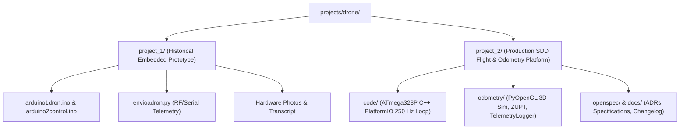

# 🚁 Project Manifest: Drone Subsystem Workspace (`projects/drone`)

Standard Level 1 interface manifest for the `drone` autonomous workspace within the Maestro ecosystem, complying with Maestro's `my_auto_document` (The Scribe) standard.

---

## 📌 Project Identity & Metadata

- **Workspace Path:** `projects/drone/`
- **Domain Tags:** `#drone` `#flight-controller` `#embedded-c` `#odometry` `#zupt` `#mpu6050` `#simulation` `#sdd`
- **Status:** Active (Stage 1 IMU Attitude & 3D Inertial Odometry v0.5.0)
- **Primary Orchestrator Integration:** Registered in Maestro Federated Master Index (`00_MAESTRO_INDEX.md`).

---

## 📂 Sub-Project Topology

The `drone` workspace contains two distinct architectural sub-systems:

| Sub-Project | Primary Purpose | Tech Stack | Status | Documentation |
| :--- | :--- | :--- | :---: | :--- |
| **`project_1/`** | **Embedded Drone Prototype & RF Controller.** Historical hardware prototype demonstrating 4-motor tilt stabilization, dual Arduino transceivers (RF communication), and Python telemetry. | Arduino C (`.ino`), Python serial, RF module | Historical Reference | [project_1/README.md](project_1/README.md) |
| **`project_2/`** | **Production SDD Flight Controller & 3D Odometry.** Production-grade 250 Hz deterministic flight controller firmware, 25 Hz decimated UART telemetry, 6-DoF inertial odometry with ZUPT, dual-tier telemetry logger, and 3D visualizer. | PlatformIO, C++, Python 3.12, Pygame, PyOpenGL, Pytest | Active (v0.5.0) | [project_2/README.md](project_2/README.md) · [project_2/PROJECT.md](project_2/PROJECT.md) |

---

## 🏛️ Maestro Documentation & SDD Standards

This workspace adheres strictly to Maestro's **Zero Doc-Drift & 7 Golden Gates** (`my_auto_document`):
1. **Gate 1 (Executable Verification):** All CLI scripts and pytest suites execute inside `project_2/.venv`.
2. **Gate 2 (Lightweight ADRs):** Key decisions are preserved in `project_2/docs/adr/`.
3. **Gate 3 (Contract Parity):** All UART serial packets and simulator arguments conform to OpenSpec specs.
4. **Gate 4 (Standard Mermaid):** All diagrams use standard default themes without custom color overrides.
5. **Gate 5 (Active Link Health):** Zero `file://` URIs inside markdown files.
6. **Gate 6 (Security & Integrity):** No credentials or untrusted execution vectors.
7. **Gate 7 (Master README):** Humanized operational documentation with verified 1-line commands.
