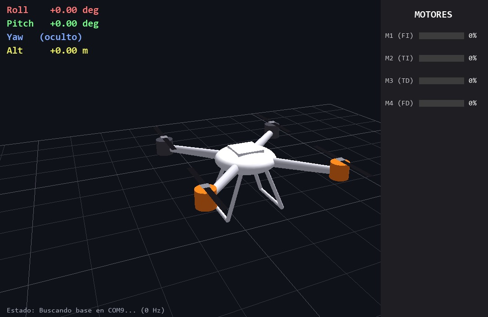
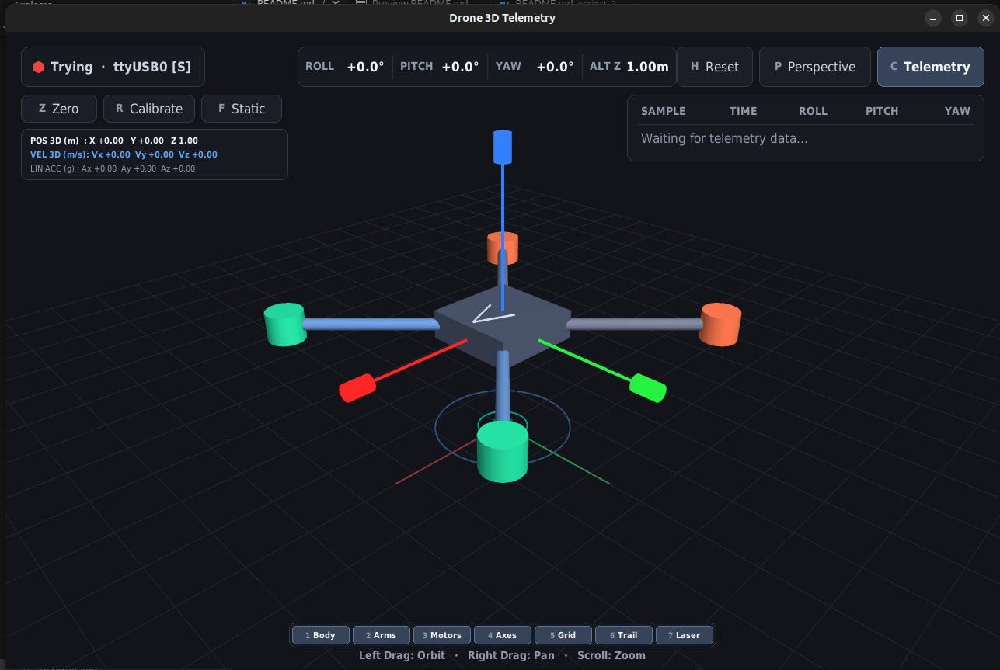
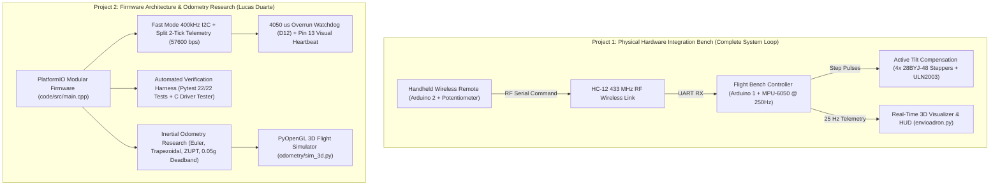

# Autonomous Quadcopter Embedded Flight Controller & 3D Odometry Research

[]()
[-orange.svg)](https://www.arduino.cc/)
[](https://platformio.org/)
[](https://eesc.usp.br/)
[](LICENSE)

> **Academic Coursework:** SAA0356 - Sistemas Embarcados para Veículos Aéreos (Turma 201)  
> **Institution:** Escola de Engenharia de São Carlos, Universidade de São Paulo (EESC - USP)  
> **Faculty Advisor:** [Prof. Dr. Glauco Augusto de Paula Caurin](https://saa.eesc.usp.br/inicial/docentes/professor-glauco-augusto-de-paula-caurin/) · [CNPq Lattes](https://buscatextual.cnpq.br/buscatextual/visualizacv.do;jsessionid=5DDECA9F6260EAC787DD75C20FAF833C.buscatextual_0)  
> **Authors / Development Team:** David Santiago Correa González, Juan Pablo Solano Mesa, Diego Alonso, Lucas Duarte  

---

## 1. System Overview & Evolutionary Architecture

<div align="center" style="margin-bottom: 24px;">
  <table style="width: 100%; max-width: 960px; border-collapse: separate; border-spacing: 12px; border: none;">
    <tr>
      <td width="50%" align="center" style="border: 1px solid #30363d; border-radius: 8px; padding: 12px; background-color: #0d1117; vertical-align: top;">
        <a href="project_1/README.md">
          
        </a>
        <br><br>
        <strong><a href="project_1/README.md">Project 1: Physical Test Bench</a></strong>
        <br>
        <small style="color: #8b949e;">Dual ATmega328P, HC-12 433 MHz RF, MPU-6050 & 4x Stepper Motors with Active Tilt Compensation</small>
      </td>
      <td width="50%" align="center" style="border: 1px solid #30363d; border-radius: 8px; padding: 12px; background-color: #0d1117; vertical-align: top;">
        <a href="project_2/README.md">
          
        </a>
        <br><br>
        <strong><a href="project_2/README.md">Project 2: 3D Odometry & Firmware</a></strong>
        <br>
        <small style="color: #8b949e;">250 Hz Deterministic Loop, 25 Hz Decimated UART & PyOpenGL 3D Simulator with ZUPT</small>
      </td>
    </tr>
  </table>
</div>

This repository hosts the autonomous quadcopter embedded flight control and inertial navigation systems developed for course SAA0356 at EESC-USP. The codebase reflects two complementary, phased engineering projects:



### 1.1 Project Synergy: Hardware Integration vs. Theoretical Rigor
- **[Project 1 (`project_1/`)](project_1/README.md) — Complete Physical Test Bench:**  
  Delivers the full physical hardware realization. Developed collaboratively by the team, Project 1 closes the entire physical loop: reading an MPU-6050 over I2C, receiving wireless motor commands from a handheld remote over HC-12 433 MHz RF, computing proportional tilt compensation, driving four 28BYJ-48 stepper motors with ULN2003 Darlington arrays, and streaming real-time orientation to a Pygame/PyOpenGL 3D visualizer. Project 1 audits and corrects all hardware and memory defects present in the reference course prototype (`example_01.ino`).

- **[Project 2 (`project_2/`)](project_2/README.md) — Modular Architecture & Inertial Odometry Research:**  
  Authored individually by Lucas Duarte, Project 2 establishes a production-grade firmware architecture and rigorous mathematical investigation governed by **Spec-Driven Development (SDD)** and **Test-Driven Development (TDD)**. It features an isolated PlatformIO toolchain, deterministic $4000\,\mu\text{s}$ timing with hardware overrun watchdogs, 2-tick serial telemetry, and 22 automated Pytest unit tests. Critically, Project 2 conducts a formal study on inertial dead-reckoning (ZUPT, deadband, quadratic integration drift $\iint a\,dt^2$), demonstrating why standalone IMU integration diverges over time and establishing the mathematical requirement for multi-sensor Kalman filtering.

---

## 2. Cross-Project Technical Comparison

| Dimension | Project 1: Physical Bench Prototype | Project 2: Firmware Architecture & Odometry |
| :--- | :--- | :--- |
| **Primary Scope** | Full physical bench implementation (hardware-in-the-loop). | Architecture, timing determinism, and odometry research. |
| **Authorship** | David González, Juan Pablo Mesa, Diego Alonso, Lucas Duarte. | Lucas Duarte. |
| **Build System** | Arduino IDE / PlatformIO compatible (`.ino`). | PlatformIO CLI with isolated environments (`platformio.ini`). |
| **Microcontroller** | Dual ATmega328P (Flight Controller + Remote Controller). | ATmega328P @ 16 MHz (Arduino Uno / Nano). |
| **Control Loop Timing** | $4000\,\mu\text{s}$ ($250\text{ Hz}$) loop with non-blocking stepper scheduler. | Strict $4000\,\mu\text{s}$ ($250\text{ Hz}$) loop with $4050\,\mu\text{s}$ D12 watchdog. |
| **Actuators** | 4x 28BYJ-48 unipolar steppers + ULN2003 drivers. | Spec-driven ESC pulse generator roadmap (`PORTD` D4–D7). |
| **Wireless RF Link** | HC-12 433 MHz UART transceiver (`SoftwareSerial`). | Serial telemetry with phase-latched 2-tick transmission. |
| **Motor Control Law** | Proportional differential tilt reaction ($k = 2.0$). | Cascaded rate/angle PID specifications with EEPROM calibration. |
| **Telemetry Streaming** | ASCII stream at 25 Hz ($115{,}200\text{ bps}$). | Split 2-tick decimated stream at 25 Hz ($57{,}600\text{ bps}$). |
| **Inertial Odometry** | Earth-frame gravity rotation and leaky vertical displacement. | Formal evaluation of Euler vs. Trapezoidal vs. ZUPT with $0.05g$ deadband. |
| **Automated Testing** | Visual validation on bench and PyOpenGL visualizer. | 22/22 passing automated Pytest tests + host C driver tester. |
| **Documentation Link** | 📖 **[project_1/README.md](project_1/README.md)** | 📖 **[project_2/README.md](project_2/README.md)** |

---

## 3. Featured Multimedia Demonstrations

### 3.1 Project 1: Physical Bench Video Demonstration
The physical test bench, dual-Arduino wireless RF link, and active stepper tilt compensation were recorded during laboratory testing:

<div align="center">
  <a href="https://www.youtube.com/watch?v=eWvYoFlVz2w" target="_blank">
    
  </a>
  <p><em>Click the image above to view the demonstration on YouTube: <a href="https://www.youtube.com/watch?v=eWvYoFlVz2w">https://www.youtube.com/watch?v=eWvYoFlVz2w</a></em></p>
</div>

**Demonstration Key Moments (from `project_1/transcribe.txt`):**
1. **Wireless Remote Operation:** Demonstration of the handheld Arduino remote transmitting throttle commands via HC-12 radiofrequency.
2. **Pitch Axis Compensation:** Manually tilting the platform forward accelerates the front stepper motors to counteract the tilt; tilting backward accelerates the rear motors.
3. **Roll Axis Compensation:** Tilting left or right activates the corresponding motor pairs to level the airframe.
4. **3D Telemetry Synchronization:** The Pygame/PyOpenGL 3D visualizer mirrors bench attitude in real time.

### 3.2 Project 2: 3D Odometry & Inertial Simulation Video
The real-time MPU-6050 attitude tracking, live serial telemetry ingestion, and PyOpenGL 3D simulation were recorded:

<div align="center">
  <a href="https://www.youtube.com/shorts/7p0rP1CsYMk" target="_blank">
    
  </a>
  <p><em>Click the image above to view the demonstration on YouTube: <a href="https://www.youtube.com/shorts/7p0rP1CsYMk">https://www.youtube.com/shorts/7p0rP1CsYMk</a></em></p>
</div>

---

## 4. Repository Structure & Living Documentation

```
projects/drone/
├── README.md                                 # Root Entry Point & Academic Dashboard
├── PROJECT.md                                # Workspace Manifest
├── docs/                                     # Global Architecture & Governance
│   └── KNOWLEDGE_GAPS_REPORT.md              # Action Report: Missing Datasheets & Assets
├── openspec/                                 # Root OpenSpec (Ephemeral Development Harness)
│   ├── config.yaml
│   └── changes/global-documentation-release/ # Global Documentation Delta Specs
├── project_1/                                # Physical Quadcopter Test Bench
│   ├── README.md                             # Subsystem Specification & Wiring Guide
│   ├── arduino1dron.ino                      # Flight controller & stepper motor firmware
│   ├── arduino2control.ino                   # Remote control RF transmitter firmware
│   ├── envioadron.py                         # Pygame + PyOpenGL 3D ground station
│   ├── transcribe.txt                        # Audio transcript of physical bench video
│   ├── images/                               # Hardware photographs and wiring diagrams
│   │   ├── platform.jpeg                     # Assembled physical bench photo
│   │   └── exploded_hardware_connections.jpeg # Wiring schematic diagram
│   └── openspec/                             # Project 1 Ephemeral OpenSpec Harness
└── project_2/                                # Production Firmware & Odometry Research
    ├── README.md                             # Subsystem Technical Guide & Odometry Analysis
    ├── VERSION                               # Semantic Version (0.6.0)
    ├── platformio.ini                        # PlatformIO multi-environment configuration
    ├── code/                                 # Embedded C/C++ firmware
    │   ├── include/drone_config.h            # Timing, pinout, and filter constants
    │   ├── include/imu_attitude.h            # Single-source pure C kinematic math routines
    │   ├── src/main.cpp                      # Deterministic 250 Hz flight controller
    │   └── src/i2c_finder.cpp                # 100 kHz I2C scanner & pull-up diagnostic
    ├── odometry/                             # 3D Simulation & Verification Engine
    │   ├── sim_3d.py                         # PyOpenGL flight simulator with ZUPT
    │   ├── drone_model.py                    # 3D geometry & InertialPositionEstimator
    │   ├── telemetry_reader.py               # Serial reader & circular buffer
    │   ├── telemetry_logger.py               # Dual-tier telemetry & diagnostics logger
    │   ├── tester.c                          # Standalone C driver tester
    │   └── tests/                            # Automated Pytest suite (22 unit tests)
    ├── docs/                                 # Subsystem Architecture & ADR Records
    │   ├── system_architecture.md            # Bottom-Up 5-layer hardware & register maps
    │   ├── system_purpose.md                 # 4-stage incremental roadmap
    │   ├── CHANGELOG.md                      # Chronological version history
    │   └── adr/                              # Architectural Decision Records (ADR 1–4)
    ├── images/sim_3d_visualizer/             # Simulator screenshot gallery
    │   └── 3d_simulation.png                 # PyOpenGL 3D visualizer interface screenshot
    └── openspec/                             # Project 2 Ephemeral OpenSpec Harness
```

---

## 5. Quick Operational Command Table

All commands below are verified to execute cleanly in the Linux workspace:

| Target Subsystem | Action | Verified Command | Operational Purpose |
| :--- | :--- | :--- | :--- |
| **Project 2** | **Run All Unit Tests** | `cd project_2 && .venv/bin/pytest odometry/tests/ -v` | Runs 22 unit tests in ~0.20s (Validates kinematics, ZUPT, and buffers) |
| **Project 2** | **Compile Firmware** | `cd project_2 && pio run -e uno` | Builds `code/src/main.cpp` using Atmel AVR toolchain |
| **Project 2** | **Flash Arduino** | `cd project_2 && pio run -e uno -t upload` | Flashes ATmega328P flight controller via `/dev/ttyUSB1` |
| **Project 2** | **Launch 3D Simulator** | `cd project_2 && .venv/bin/python odometry/sim_3d.py --port /dev/ttyUSB1` | Starts real-time 3D simulator reading live MPU-6050 telemetry |
| **Project 2** | **Verbose Diagnostics** | `cd project_2 && .venv/bin/python odometry/sim_3d.py --port /dev/ttyUSB1 -v` | Streams per-frame math, clamp states, and ZUPT tags |
| **Project 1** | **Launch Ground Station**| `cd project_1 && python3 envioadron.py --port /dev/ttyUSB0 --baud 115200` | Starts Pygame/PyOpenGL visualizer reading Project 1 RF telemetry |
| **Workspace** | **Update Knowledge Graph**| `graphify update .` | Synchronizes GraphRAG knowledge graph without API token consumption |

---

## 6. OpenSpec Ephemeral Lifecycle Governance

> [!IMPORTANT]
> **Internal Development Policy:**  
> All `openspec/` directories within this repository (`openspec/`, `project_1/openspec/`, and `project_2/openspec/`) represent internal Spec-Driven Development contracts used to govern atomic tasks, design trade-offs, and verification criteria. Prior to any final public open-source Git tag release, these internal specification folders will be omitted from the packaging manifest, leaving the root `README.md`, subsystem READMEs, and the comprehensive `docs/` directories as the sole living technical documentation.
