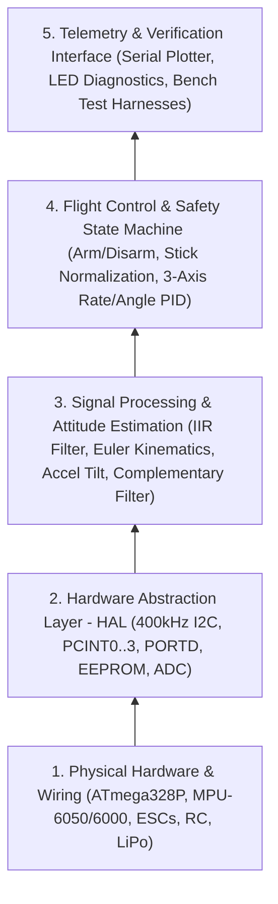
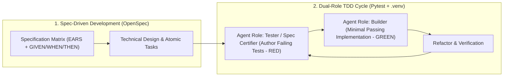

# Arduino Quadcopter Flight Controller (`drone`) — Master SDD Guide

> **Deterministic 250 Hz Embedded Flight Stabilization Platform**  
> **Target MCU:** Arduino Uno (ATmega328P @ 16 MHz) · **IMU:** MPU-6050 / MPU-6000 (I2C 400 kHz) · **Methodology:** Spec-Driven Development (SDD)  
>
> This repository is governed by **Bottom-Up Spec-Driven Development (SDD)** and **OpenSpec**. All documentation, mathematical models, and firmware modules are structured hierarchically from physical hardware constraints at the base up to closed-loop flight control and telemetry at the top.

---

## 🌎 Bottom-Up SDD Documentation Index

To understand the platform or modify a requirement, navigate the architecture **from bottom to top (from physical hardware to flight control)**:

| Layer | System Domain | Specification & Documentation (Direct Link) | Primary Scope |
| :---: | :--- | :--- | :--- |
| **Manifest** | **Project Identity** | 📄 **[PROJECT.md](PROJECT.md)** | Maestro Level 1 manifest, domain tags, and phased overview. |
| **General** | **Docs Hub Index** | 📂 **[docs/README.md](docs/README.md)** | Guide to human and AI agent documentation governance. |
| **General** | **System Purpose** | 📄 **[docs/system_purpose.md](docs/system_purpose.md)** | Objectives, 4-stage incremental roadmap, actors, and safety boundaries. |
| **General** | **System Architecture** | 📄 **[docs/system_architecture.md](docs/system_architecture.md)** | Bottom-Up 5-layer architecture, pinout, math equations, Appendix B globals, and prototype audit. |
| **Stage 1** | **IMU Attitude Spec** | 📜 **[openspec/specs/stage-1-imu-attitude/spec.md](openspec/specs/stage-1-imu-attitude/spec.md)** | Normative EARS requirements for MPU-6050/6000 setup, calibration, and complementary filter. |
| **Stage 2** | **RC Receiver Spec** | 📜 **[openspec/specs/stage-2-rc-receiver/spec.md](openspec/specs/stage-2-rc-receiver/spec.md)** | Planned requirements for `PCINT0..3` PWM capture, EEPROM bounds, and stick normalization *(Open)*. |
| **Stage 3/4** | **Motor & PID Spec** | 📜 **[openspec/specs/stage-3-motor-control/spec.md](openspec/specs/stage-3-motor-control/spec.md)** | Planned requirements for motor testing, arm/disarm state machine, PID, and `PORTD` pulses *(Open)*. |
| **Base** | **Reference Material** | 📁 **[ref/DRONE_materialdeapoio/](ref/DRONE_materialdeapoio/)** | Original EESC-USP guide PDF, MPU-6000 datasheets, YMFC schematic, and `example_01.ino` prototype. |
| **Firmware** | **Embedded C/C++ Code** | 📂 **[code/](code/)** | PlatformIO firmware sources (`code/src/main.cpp`) and headers (`code/include/`). |

---

## 🚦 Phased Development Status

| Stage | Milestone | Status | Key Deliverables |
| :---: | :--- | :---: | :--- |
| **Stage 1** | **Aircraft Attitude Determination (IMU)** | 🟡 **In Progress** | I2C 400 kHz driver, 2000-sample gyro calibration, $0.7/0.3$ digital filter, Euler kinematics, $0.9996/0.0004$ complementary filter, `example_01.ino` bug remediation. |
| **Stage 2** | **RC Receiver PWM & EEPROM Calibration** | ⚪ **Open** | `ISR(PCINT0_vect)` on `D8`–`D11`, EEPROM address map (`0`–`23`), linear normalization ($1000\text{–}2000\,\mu\text{s}$). |
| **Stage 3** | **Motor Testing & Arm/Disarm Logic** | ⚪ **Open** | Individual/all motor bench test (`1`–`5`), `start` state machine (`0, 1, 2`) via `THRO` + `RUDD`. |
| **Stage 4** | **PID Flight Stabilization & Battery Comp.** | ⚪ **Open** | 3-axis PID controller, $\pm 8\,\mu\text{s}$ deadband, `A0` battery sensing & sag compensation, synchronous 250 Hz `PORTD` ESC pulse generation. |

---

## 🧪 SDD & Dual-Role TDD Governance Matrix

All development across the `drone` project MUST strictly conform to **Spec-Driven Development (SDD)** and **Dual-Role Test-Driven Development (TDD)**:

1. **Specification Before Code:** Every feature or driver must possess a formal OpenSpec matrix under `openspec/changes/` before implementation begins.
2. **Dual-Role Separation:** A dedicated testing role crafts the test suite in Python (`pytest`) asserting against the exact scenario constraints. The builder role subsequently writes minimal production code to satisfy the tests.
3. **Controlled Python Test Harness:** High-control test suites run in isolated Python virtual environments (`.venv`), providing end-to-end certification of mathematical filters, communication buffers, and telemetry decoders.
4. **Live Odometry & Inspection Platform (`odometry/`):** A dedicated real-time 3D telemetry visualization and C driver tester environment allows on-the-fly verification and dimensional validation of attitude math and hardware signals.

---

## ⚙️ Bottom-Up Spec Propagation Rules

> [!IMPORTANT]
> **Strict Bottom-Up Modification Flow:**  
> Any hardware or mathematical change must propagate from the base layer upward:
> 1. **Layer 1 (Hardware & Pinout):** Document physical wiring, sensor orientation, or voltage divider changes in [docs/system_architecture.md](docs/system_architecture.md).
> 2. **Layer 2 (HAL & Registers):** Update register configurations (`0x6B`, `0x1B`, `0x1C`, `0x1A`), ISR masks, or EEPROM layout in the corresponding OpenSpec specification under [openspec/specs/](openspec/specs/).
> 3. **Layer 3 & 4 (Math & Control):** Verify that all trigonometric, filtering, and PID computations execute strictly within the $4000\,\mu\text{s}$ ($250\text{ Hz}$) real-time loop window.
> 4. **Verification & Testing (TDD & Odometry):** Write and execute automated Pytest suites and validate attitude stability using the real-time 3D simulation in [odometry/](odometry/).
> 5. **Layer 5 (Knowledge Graph & Changelog):** Update [docs/CHANGELOG.md](docs/CHANGELOG.md) and run `graphify update .` to keep the knowledge graph synchronized.

---

## 🚀 Quick Operational Commands (`.venv` & PlatformIO)

| Target Task | Command | Operational Notes |
| :--- | :--- | :--- |
| **Compile Firmware** | `pio run -e uno` | Compiles `code/src/main.cpp` using Atmel AVR toolchain. |
| **Flash Arduino Uno** | `pio run -e uno -t upload` | Flashes ATmega328P via active serial port (`/dev/ttyUSB1`). |
| **Launch 3D Simulator (Standard)** | `.venv/bin/python3 odometry/sim_3d.py` | Runs real-time 3D simulation with ZUPT, $0.05g$ deadband, and 1 Hz heartbeat. |
| **Launch 3D Simulator (Verbose)** | `.venv/bin/python3 odometry/sim_3d.py -v` | Emits per-sample diagnostics with $\Delta t$, clamping tags, and ZUPT tags. |
| **Run Full TDD Test Suite** | `.venv/bin/pytest odometry/tests/` | Runs all 22 automated Pytest unit and integration tests. |
| **Compile C Driver Tester** | `make -C odometry` | Builds `odometry/tester` using host GCC. |

