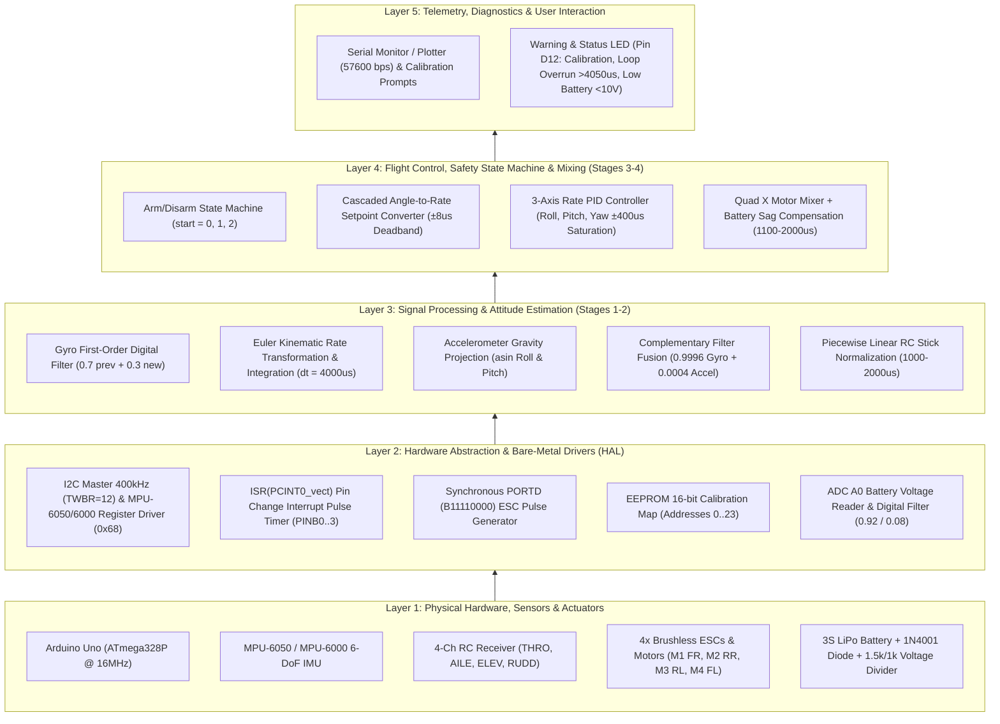
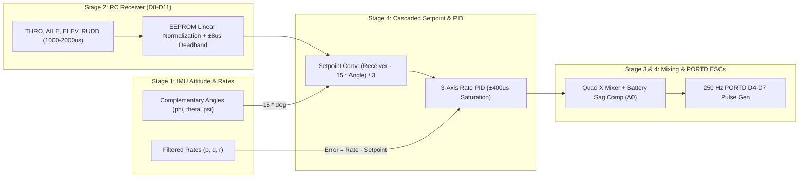
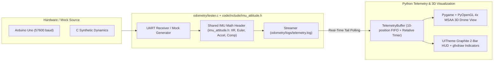

# System Architecture (`system_architecture.md`)

> **Reference Documentation — Spec-Driven Development (SDD)**  
> **Version:** 0.4.0 · **Status:** Active · **Updated:** October 2026  

---

## 1. Bottom-Up Architectural Overview

The quadcopter flight controller follows **Bottom-Up Spec Propagation**: physical electrical constraints, sensor orientation, and the hard $4000\,\mu\text{s}$ ($250\text{ Hz}$) cycle period at the base govern the register drivers, kinematic estimators, and control laws above.

---

## 2. Layer 1 & 2: Physical Hardware Pinout & Register Map

### 2.1 Arduino Uno (ATmega328P) Pin Assignment
Derived from `YMFC_schematic.pdf`, `arduino_schematics.jpg`, and `tutorial_programacao_drone_especializacao.pdf`:

| Arduino Pin | AVR Port | Direction | Subsystem | Function & Electrical Notes |
| :---: | :---: | :---: | :--- | :--- |
| **`A4` (SDA)** | `PC4` | Bidir | Stage 1 (IMU) | I2C Data line to MPU-6050/6000 (`0x68`, 400 kHz via `TWBR = 12`). |
| **`A5` (SCL)** | `PC5` | Output | Stage 1 (IMU) | I2C Clock line to MPU-6050/6000 (`0x68`, 400 kHz). |
| **`D12`** | `PB4` | Output | Stage 1–4 (LED) | Status/Warning LED via $330\,\Omega$ resistor (Calibration blink, IMU fail, Loop $>4050\,\mu\text{s}$, $V_{batt} < 10\text{ V}$). |
| **`D8`** | `PB0` (`PCINT0`) | Input | Stage 2 (RC) | Receiver Channel 1: **THRO** (Throttle / Tração). |
| **`D9`** | `PB1` (`PCINT1`) | Input | Stage 2 (RC) | Receiver Channel 2: **AILE** (Roll / Rolagem). |
| **`D10`** | `PB2` (`PCINT2`) | Input | Stage 2 (RC) | Receiver Channel 3: **ELEV** (Pitch / Arfagem). |
| **`D11`** | `PB3` (`PCINT3`) | Input | Stage 2 (RC) | Receiver Channel 4: **RUDD** (Yaw / Guinada). |
| **`D4`** | `PD4` | Output | Stage 3–4 (ESC 1) | **ESC 1 — Front Right (FR / M1)**, Counter-Clockwise (CCW). |
| **`D5`** | `PD5` | Output | Stage 3–4 (ESC 2) | **ESC 2 — Rear Right (RR / M2)**, Clockwise (CW). |
| **`D6`** | `PD6` | Output | Stage 3–4 (ESC 3) | **ESC 3 — Rear Left (RL / M3)**, Counter-Clockwise (CCW). |
| **`D7`** | `PD7` | Output | Stage 3–4 (ESC 4) | **ESC 4 — Front Left (FL / M4)**, Clockwise (CW). |
| **`A0`** | `PC0` (`ADC0`) | Analog In | Stage 4 (Battery) | 3S LiPo Voltage Monitor via `1N4001` diode + $R_3 = 1.5\text{ k}\Omega$ (high) / $R_2 = 1.0\text{ k}\Omega$ (low) divider ($12.6\text{ V} \rightarrow 5.0\text{ V}$). |

> [!NOTE]
> **Schematic Discrepancy Note (`arduino_schematics.jpg` vs. `YMFC_schematic.pdf`):**  
> The Fritzing diagram (`arduino_schematics.jpg`) labels the I2C sensor block as `L3G4200D`, which was used in the legacy YMFC-3D V1 gyro-only controller. As noted in `YMFC_schematic.pdf` Note `*4`, `MPU-6000-Datasheet1.pdf`, `RM-MPU-6000A.pdf`, `example_01.ino`, and the EESC-USP guide, this project uses the **MPU-6050 / MPU-6000** 6-axis IMU (gyroscope + accelerometer) at I2C address `0x68`.

### 2.2 MPU-6050 / MPU-6000 Register Configuration (`0x68`)
Configured in `set_gyro_registers()` (Appendix A.1):

| Register (Hex) | Register Name | Written Value | Configuration Meaning | Scale Factor / Sensitivity |
| :---: | :--- | :---: | :--- | :--- |
| **`0x6B`** | `PWR_MGMT_1` | `0x00` (`00000000b`) | Wake up device, internal 8 MHz oscillator. | — |
| **`0x1B`** | `GYRO_CONFIG` | `0x08` (`00001000b`) | `FS_SEL = 1`: Full-scale range $\pm 500\text{ deg/s}$. Verified by readback check (`!= 0x08` halts + lights D12). | $65.5\text{ LSB / (deg/s)}$ |
| **`0x1C`** | `ACCEL_CONFIG` | `0x10` (`00010000b`) | `AFS_SEL = 2`: Full-scale range $\pm 8g$. | $4096\text{ LSB / }g$ |
| **`0x1A`** | `CONFIG` | `0x03` (`00000011b`) | `DLPF_CFG = 3`: Internal Digital Low-Pass Filter $\sim 43\text{ Hz}$ (Accel $44\text{ Hz}$, Gyro $42\text{ Hz}$). | — |
| **`0x3B`–`0x48`** | `ACCEL_XOUT_H` .. `GYRO_ZOUT_L` | Burst Read (14 bytes) | `0x3B..0x40`: Accel X, Y, Z (int16 big-endian) `0x41..0x42`: Temperature (int16) `0x43..0x48`: Gyro X, Y, Z (int16 big-endian). | Big-endian (`high << 8 \| low`) |

---

## 3. Layer 3: Aircraft Coordinate Frame & Stage 1 Mathematical Pipeline

### 3.1 Body Reference Coordinate Frame
Per Section 2.4 of the EESC-USP guide, the body-fixed reference frame $(x, y, z)$ with origin at the aircraft Center of Gravity (CG) is defined as:
- **$x$-axis:** Directed from CG toward the **nose** (forward). Positive roll rate $p$ and positive roll angle $\phi$ correspond to **left side up / right wing down**.
- **$y$-axis:** Directed from CG toward the **right side** (starboard). Positive pitch rate $q$ and positive pitch angle $\theta$ correspond to **nose up**.
- **$z$-axis:** Directed from CG **downward** toward the center of the Earth (when level). Positive yaw rate $r$ and positive yaw angle $\psi$ correspond to **clockwise rotation viewed from above**.
- **Stationary Level Gravity Reading:** When resting flat and level, the accelerometer measures $(Acc_x, Acc_y, Acc_z) = (0, 0, +g)$.

### 3.2 Gyroscope Bias Calibration & First-Order Digital Filter (Eq. 1–3)
1. **Startup Bias Calibration:** Takes $N = 2000$ samples while stationary in `setup()`, computing the mean offset $(\bar{p}_{offset}, \bar{q}_{offset}, \bar{r}_{offset})$ and subtracting it from every subsequent raw measurement.
2. **Conversion to Degrees per Second:** Raw bias-corrected counts are divided by $65.5\text{ LSB/(deg/s)}$ to obtain $p_{new}, q_{new}, r_{new}$ in $\text{deg/s}$.
3. **First-Order IIR Digital Filter:**
   $$p^{k+1} = 0.7\,p^k + 0.3\,p_{new}$$
   $$q^{k+1} = 0.7\,q^k + 0.3\,q_{new}$$
   $$r^{k+1} = 0.7\,r^k + 0.3\,r_{new}$$

### 3.3 Euler Angle Kinematic Integration from Gyroscope (Eq. 4–7)
Relating body angular rates $(p^{k+1}, q^{k+1}, r^{k+1})$ to Euler angle rates $(\dot{\phi}_{gyro}^{k+1}, \dot{\theta}_{gyro}^{k+1}, \dot{\psi}_{gyro}^{k+1})$ and integrating over $\Delta t = 0.004\text{ s}$ ($250\text{ Hz}$):

$$\begin{bmatrix} \dot{\phi}_{gyro}^{k+1} \\ \dot{\theta}_{gyro}^{k+1} \\ \dot{\psi}_{gyro}^{k+1} \end{bmatrix} = \begin{bmatrix} 1 & \tan\theta^k\sin\phi^k & \tan\theta^k\cos\phi^k \\ 0 & \cos\phi^k & -\sin\phi^k \\ 0 & \sin\phi^k\sec\theta^k & \cos\phi^k\sec\theta^k \end{bmatrix} \begin{bmatrix} p^{k+1} \\ q^{k+1} \\ r^{k+1} \end{bmatrix}$$

$$\phi_{gyro}^{k+1} = \phi^k + \left(p^{k+1} + q^{k+1}\tan\theta^k\sin\phi^k + r^{k+1}\tan\theta^k\cos\phi^k\right)\Delta t$$
$$\theta_{gyro}^{k+1} = \theta^k + \left(q^{k+1}\cos\phi^k - r^{k+1}\sin\phi^k\right)\Delta t$$
$$\psi^{k+1} = \psi^k + \left(q^{k+1}\sin\phi^k\sec\theta^k + r^{k+1}\cos\phi^k\sec\theta^k\right)\Delta t$$

*(Note: In C/C++, $\phi^k$ and $\theta^k$ passed to `sin()`, `cos()`, `tan()` must be converted from degrees to radians via $\pi/180$.)*

### 3.4 Accelerometer Gravity Projection (Eq. 8–10)
Total acceleration magnitude and low-frequency tilt angles (converted to degrees via $180/\pi$):
$$Acc_{Total} = \sqrt{Acc_x^2 + Acc_y^2 + Acc_z^2}$$
$$\phi_{acc}^{k+1} = \arcsin\left(\frac{Acc_y}{Acc_{Total}}\right) \cdot \frac{180}{\pi}$$
$$\theta_{acc}^{k+1} = -\arcsin\left(\frac{Acc_x}{Acc_{Total}}\right) \cdot \frac{180}{\pi}$$

### 3.5 Complementary Filter Fusion (Eq. 11–12)
Combines high-frequency gyroscope integration ($\alpha = 0.9996$) with low-frequency accelerometer drift correction ($1 - \alpha = 0.0004$):
$$\phi^{k+1} = 0.9996\,\left(\phi^k + \dot{\phi}_{gyro}^{k+1}\Delta t\right) + 0.0004\,\phi_{acc}^{k+1}$$
$$\theta^{k+1} = 0.9996\,\left(\theta^k + \dot{\theta}_{gyro}^{k+1}\Delta t\right) + 0.0004\,\theta_{acc}^{k+1}$$

---

## 4. Layer 3 & 4: Planned Stages 2, 3, and 4 Architecture (Open)

1. **Stage 2 — EEPROM & Normalization (Eq. 13):**
   - EEPROM Layout (2-byte little-endian integers):
     - `THRO`: Center `0,1` · Low `8,9` · High `16,17`
     - `AILE`: Center `2,3` · Low `10,11` · High `18,19`
     - `ELEV`: Center `4,5` · Low `12,13` · High `20,21`
     - `RUDD`: Center `6,7` · Low `14,15` · High `22,23`
2. **Stage 3 — Motor Testing & Arm/Disarm (`start`):**
   - Motor IDs: `1 = FR (ESC1/D4)`, `2 = RR (ESC2/D5)`, `3 = RL (ESC3/D6)`, `4 = FL (ESC4/D7)`, `5 = ALL`.
   - Arming Sequence: `start = 0` (disarmed, $1000\,\mu\text{s}$) $\rightarrow$ `THRO < 1050 && RUDD < 1050` sets `start = 1` $\rightarrow$ `THRO < 1050 && RUDD > 1450` sets `start = 2` (armed, resets PID memories, initializes $\phi=\phi_{acc}, \theta=\theta_{acc}$, idle $\ge 1100\,\mu\text{s}$). Disarm: `start == 2 && THRO < 1050 && RUDD > 1950` sets `start = 0`.
3. **Stage 4 — Setpoint, PID, Mixing & Battery (Eq. 14–35):**
   - Deadband: $\pm 8\,\mu\text{s}$ around $1500\,\mu\text{s}$ ($[1492, 1508]\,\mu\text{s} \rightarrow 0$).
   - Setpoints: $p_{setpoint} = (\text{Receiver}_{AILE} - 15\phi)/3$, $q_{setpoint} = (\text{Receiver}_{ELEV} - 15\theta)/3$, $r_{setpoint} = (\text{Receiver}_{RUDD} - 15\psi)/3$ (or pure rate on yaw if configured).
   - Quad X Motor Mixing (with `throttle` capped at $1800\,\mu\text{s}$ before mixing, saturated to $[1100, 2000]\,\mu\text{s}$):
     - `esc_1` (FR, CCW) $= \text{Throttle} + PID_\phi - PID_\theta - PID_\psi$
     - `esc_2` (RR, CW)  $= \text{Throttle} + PID_\phi + PID_\theta + PID_\psi$
     - `esc_3` (RL, CCW) $= \text{Throttle} - PID_\phi + PID_\theta - PID_\psi$
     - `esc_4` (FL, CW)  $= \text{Throttle} - PID_\phi - PID_\theta + PID_\psi$

---

## 5. Canonical Global Variables Contract (Appendix B)

Per Section 1 and Appendix B of `tutorial_programacao_drone_especializacao.pdf`, these global variable names should be preserved across stages:

| Variable Name(s) | Type | Stage | Description |
| :--- | :--- | :---: | :--- |
| `acc_x`, `acc_y`, `acc_z` | `long` | 1 | Raw 3-axis accelerometer readings from IMU |
| `gyro_roll`, `gyro_pitch`, `gyro_yaw` | `double` | 1 | Raw/scaled angular velocities ($p, q, r$) |
| `gyro_roll_offset`, `gyro_pitch_offset`, `gyro_yaw_offset` (or `gyro_axis_cal[3]`) | `double` | 1 | Stationary gyroscope calibration offsets |
| `gyro_roll_input`, `gyro_pitch_input`, `gyro_yaw_input` | `double` | 1, 4 | Digital-filtered angular velocities ($\text{deg/s}$) |
| `angle_roll_acc`, `angle_pitch_acc` | `float` | 1 | Euler angles estimated from accelerometer ($\text{deg}$) |
| `angle_roll`, `angle_pitch` (and `angle_yaw`) | `float` | 1, 4 | Final fused attitude Euler angles ($\text{deg}$) |
| `loop_timer` | `unsigned long` | 1–4 | $4000\,\mu\text{s}$ ($250\text{ Hz}$) primary control loop timer |
| `last_channel_1..4` | `byte` | 2 | Pin state trackers for `PCINT0..3` |
| `receiver_input_channel_1..4` | `volatile int` | 2 | Raw/normalized PWM pulse widths ($\mu\text{s}$) |
| `center_channel_1..4`, `high_channel_1..4`, `low_channel_1..4` | `int` | 2 | EEPROM-stored stick calibration bounds |
| `esc_1..4`, `throttle`, `battery_voltage` | `int` | 3–4 | ESC pulse widths ($\mu\text{s}$), throttle, and scaled $V_{batt}$ |
| `timer_channel_1..4` | `unsigned long` | 3–4 | Falling-edge timestamps for `PORTD` pulse generation |
| `pid_output_roll/pitch/yaw`, `pid_i_mem_roll/pitch/yaw`, `pid_last_roll/pitch/yaw_d_error`, `pid_roll/pitch/yaw_setpoint` | `float` | 4 | PID controller states, outputs, and setpoints |

---

## 6. Audit of Reference Prototype (`example_01.ino` vs. PDF Guide)

> [!WARNING]
> **Critical Defects Identified in `ref/DRONE_materialdeapoio/example_01.ino`:**  
> Before running Stage 1 on hardware, the following issues found in `example_01.ino` must be corrected:
> 1. **Out-of-Bounds Array Indexing (Memory Corruption):**
>    - Line 13 & 21 declare `int acc_axis[3], gyro_axis[3];` and `double gyro_axis_cal[3];` (valid indices `0, 1, 2`).
>    - In `setup()` (Lines 48–50), the code reads `gyro_axis[1]`, `gyro_axis[2]`, and `gyro_axis[3]` (out-of-bounds!).
>    - In `gyro_signalen()` (Lines 140–142), the code subtracts `gyro_axis_cal[1]`, `gyro_axis_cal[2]`, and `gyro_axis_cal[3]` (out-of-bounds!) from `gyro_axis[0..2]`.
> 2. **Compilation Syntax Errors:**
>    - Line 34–35: `data` is used (`while(Serial.available())data = Serial.read();`) without being declared.
>    - Line 37: `intro()` is missing a trailing semicolon `;`.
> 3. **Missing `pinMode(12, OUTPUT)`:**
>    - Line 44 toggles pin 12 (`digitalWrite(12, !digitalRead(12))`) without setting `pinMode(12, OUTPUT)` in `setup()`.
> 4. **Unimplemented Attitude Equations (`//TODO: compute the angles`):**
>    - Line 70 leaves the gyro scaling, $0.7/0.3$ digital filter, Euler rate kinematics, and accelerometer `asin()` projections unimplemented, and Lines 78–79 apply `angle_pitch = angle_pitch * 0.9996 + angle_pitch_acc * 0.0004` without adding the gyro rate increment $\dot{\theta}_{gyro}\Delta t$ inside the $0.9996$ term (compare Eq. 11–12 of the PDF).

---

## 7. Build Ecosystem & Real-Time Engineering Decisions (`/grill-me` Alignment)

1. **Clean Code Encapsulation & Multi-Environment PlatformIO (`platformio.ini`):**
   - Managed entirely via PlatformIO CLI (`pio run`, `pio test`).
   - Embedded firmware sources and headers are cleanly isolated within the dedicated `code/` directory:
     - `code/src/main.cpp`: Primary Stage 1 flight controller firmware.
     - `code/src/i2c_finder.cpp`: Generic 100 kHz I2C bus scanner (`0x01`..`0x7E`) & `A4`/`A5` pull-up electrical diagnostic tool.
     - `code/include/`: Shared headers (`drone_config.h`, `imu_attitude.h`).
   - `platformio.ini` explicitly directs compilation via `src_dir = code/src` and `include_dir = code/include` across two streamlined environments:
     - `[env:uno]`: Compiles `code/src/main.cpp`.
     - `[env:i2c_finder]`: Compiles `code/src/i2c_finder.cpp`.
2. **Strict Appendix B Compatibility + Single-Source Testable Math Headers:**
   - All global variables from Appendix B (`acc_x`, `gyro_roll_input`, `angle_roll`, `angle_pitch`, etc.) and exact equations (Eq. 1–12) are preserved 100%, with pure mathematical functions decoupled into `code/include/imu_attitude.h` and shared directly with `odometry/tester.c` (`-I../code/include`).
3. **Configurable IMU Axis Polarity (`code/include/drone_config.h`):**
   - `IMU_SIGN_X`, `IMU_SIGN_Y`, and `IMU_SIGN_Z` (default `+1`) allow instant axis inversion if the physical MPU-6050/6000 mounting on the frame differs from the body coordinate frame.
4. **Decimated 25 Hz Telemetry & $4050\,\mu\text{s}$ Overrun Watchdog:**
   - Serial operates at `57600` bps (`example_01.ino` default), with Serial Plotter printing decimated to 1-in-10 cycles ($25\text{ Hz}$) so UART transmission never blocks the $4000\,\mu\text{s}$ ($250\text{ Hz}$) integration loop. Exceeding $4050\,\mu\text{s}$ drives LED `D12` `HIGH`.

---

## 8. Layer 5: Odometry Subsystem, 3D Simulation & Dual-Role SDD/TDD Verification

### 8.1 Real-Time Odometry Pipeline (`odometry/`)
To inspect, debug, and certify the attitude determination pipeline in real-time, the project provides a dedicated verification stack:

1. **`odometry/tester.c`:**
   - Directly includes `code/include/imu_attitude.h` (`-I../code/include`) so host verification and embedded firmware share a single source of truth for attitude math.
   - Implements UART serial reader (`/dev/ttyACM*` or `/dev/ttyUSB*` at `57600` bps) with non-blocking I/O, plus an autonomous synthetic mock mode (`-m` / `--mock`) reproducing realistic 3D quadcopter kinematics when hardware is unplugged.
   - Flushes telemetry continuously into `odometry/logs/telemetry.log` (`timestamp_ms,roll,pitch,yaw,acc_x,acc_y,acc_z`).
2. **`odometry/telemetry_reader.py`:**
   - Polls the tail of `odometry/logs/telemetry.log` with file inode tracking and offset management, or reads directly from hardware USB serial via `SerialPlotPoller`.
   - Maintains a strict 10-position FIFO circular buffer (`collections.deque(maxlen=10)`).
   - Computes real-time connection state (`Online` if data received within `< 1.0s`, otherwise `Offline`).
3. **`odometry/sim_3d.py` (Anti-AI Slop Graphite `UITheme` & 4x MSAA OpenGL):**
   - Renders a 3D drone model comprising a central cuboid fuselage, 4 cylindrical diagonal arms, 4 vertical cylindrical motors, and an RViz-style 3-axis IMU triad at the origin.
   - Enables hardware **4x MSAA** (`GL_MULTISAMPLEBUFFERS=1`, `GL_MULTISAMPLESAMPLES=4` with safe fallback), `GL_LINE_SMOOTH`, and `pygame.gfxdraw` anti-aliased 2D status dots.
   - Organizes the interface into a High-DPI **2-Bar Graphite Instrument Layout (English-Only Default UI Standard)** governed by `UITheme`:
     - **Top Instrument Bar (`52px`)**: Left clickable status & serial-release pill (`Online · ttyUSBx [S]`, `Port Free · ttyUSBx [S]`, `Online · Simulation`, `Offline · No Signal`), center 3-column Attitude Readout (`ROLL`, `PITCH`, `YAW` in `22px` bold tabular monospace), and right action pills (`H Reset`, `R Calibrate`, `P Perspective`/`Isometric`, `C Telemetry`).
     - **Bottom Centered Layer Dock (`24px` x `74px` compact pills)**: Interactive toggles (`1 Body`, `2 Arms`, `3 Motors`, `4 Axes`, `5 Grid`) with hover and active states.
     - **Right-Hand Telemetry Drawer (`460px` width)**: Structured 5-column table (`SAMPLE`, `TIME`, `ROLL`, `PITCH`, `YAW`) with latest-row highlight (`PANEL_ROW_LATEST`) and relative session time formatting (`format_sample_time()`).

### 8.2 Strict SDD & Dual-Role TDD Governance
- **Matrix Specification:** All subsystem capabilities and behavioral scenarios are first authored in OpenSpec (`openspec/changes/odometry-3d-simulation/`).
- **Dual-Role Execution:**
  - **Tester Role:** Author Pytest suites (`test_telemetry_reader.py`, `test_drone_model.py`) defining failing verification contracts (RED).
  - **Builder Role:** Implement minimal production code to satisfy contracts (GREEN) and refactor.
- **Isolated Environment:** Tests are executed via `pytest` inside an isolated `.venv` environment to guarantee repeatable, hermetic CI verification.

