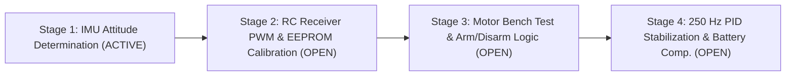

# System Purpose & Incremental Roadmap (`system_purpose.md`)

> **Reference Documentation — Spec-Driven Development (SDD)**  
> **Version:** 0.1.0 · **Status:** Active (Stage 1) · **Updated:** October 2026  

---

## 1. Core Purpose of the System

The **Arduino Quadcopter Flight Controller (`drone`)** is an embedded flight stabilization system targeting the **Arduino Uno (ATmega328P)** microcontroller and an **MPU-6050 / MPU-6000** 6-axis Inertial Measurement Unit (IMU).

The goal of the project is to build, verify, and evolve a complete quadcopter flight controller step-by-step from bare-metal register communication up to closed-loop 250 Hz PID attitude stabilization, following the EESC-USP specialization methodology (*"Guia para implementação do controle de estabilização de voo de um quadricóptero utilizando Arduino"*, Angélico, Daud Filho, Bidinotto, July 2025) and the YMFC-3D/AL hardware architecture.

---

## 2. Problems Solved by This Architecture

### 2.1 Black-Box Flight Controllers vs. White-Box Control Engineering
Off-the-shelf flight stacks (Betaflight, ArduPilot) abstract away sensor fusion and control loops across hundreds of thousands of lines of code. This project implements the complete flight control pipeline transparently in deterministic $250\text{ Hz}$ ($4000\,\mu\text{s}$) bare-metal C/C++, exposing every I2C register transaction, digital filter coefficient, Euler kinematic transformation, and PID saturation bound.

### 2.2 Safe Incremental Verification (Stage-Gated Progression)
Developing flight control software all at once risks hardware damage and unsafe prop spin-ups. By decomposing the firmware into **4 verifiable stages**, each hardware subsystem (IMU $\rightarrow$ Receiver/EEPROM $\rightarrow$ Motor Bench Test & Arming $\rightarrow$ Closed-Loop PID) is isolated, calibrated, and validated via Serial telemetry before closed-loop flight is attempted.

### 2.3 Remediation of Prototype Defects
The initial support sketch (`ref/DRONE_materialdeapoio/example_01.ino`) contains incomplete sections (`//TODO: compute the angles`), syntax errors, and out-of-bounds array indexing (`gyro_axis[1..3]` on 3-element arrays). This Spec-Driven repository audits and resolves those defects prior to hardware deployment.

---

## 3. Incremental 4-Stage Development Workflow

### 3.1 Stage 1: Aircraft Attitude Determination (IMU) — *Current Active Focus*
* **Objective:** Read raw 3-axis accelerometer and 3-axis gyroscope measurements from the MPU-6050/6000 over 400 kHz I2C, calibrate stationary gyro offsets (2000 samples), filter angular velocities ($p, q, r$), integrate Euler angles ($\phi, \theta, \psi$), compute gravity tilt projections ($\phi_{acc}, \theta_{acc}$), and fuse them via a complementary filter ($0.9996 / 0.0004$) running at $250\text{ Hz}$ ($4000\,\mu\text{s}$).
* **Verification:** Real-time visualization of roll ($\phi$), pitch ($\theta$), and yaw ($\psi$) in the Arduino Serial Plotter / Serial Monitor confirming drift-free return to $0^\circ$ when returned to a flat surface and correct sign convention ($+\phi$ left wing up, $+\theta$ nose up, $+\psi$ clockwise from top).

### 3.2 Stage 2: RC Receiver Pulse Width Measurement & EEPROM — *Open (Next Stage)*
* **Objective:** Capture 4-channel PWM signals (`THRO` on `D8`, `AILE` on `D9`, `ELEV` on `D10`, `RUDD` on `D11`) using Pin Change Interrupts (`PCINT0..3`), run an interactive setup wizard to record stick minimum, center, and maximum pulse widths into EEPROM (addresses `0`–`23`), and normalize stick inputs linearly to $1000\text{–}2000\,\mu\text{s}$ with a $1500\,\mu\text{s}$ center.

### 3.3 Stage 3: Motor Bench Testing & Start/Stop Configuration — *Open (Future Stage)*
* **Objective:** Read and verify EEPROM calibration data on startup, allow interactive serial selection (`1`–`5`) to test individual motors (`FR`, `RR`, `RL`, `FL`) or all four motors simultaneously using the throttle stick, and implement the safety arming/disarming state machine (`start = 0, 1, 2`) driven by left-stick combinations (`THRO` + `RUDD`).

### 3.4 Stage 4: Aircraft Stabilization via PID Control — *Open (Future Stage)*
* **Objective:** Close the 250 Hz control loop by combining normalized receiver commands ($\pm 8\,\mu\text{s}$ deadband) with fused Euler angles ($\phi, \theta, \psi$) into self-limiting angular rate setpoints ($p_{setpoint}, q_{setpoint}, r_{setpoint}$, max tilt $32.8^\circ$, max rate $164^\circ/\text{s}$), executing 3-axis PID control ($\pm 400\,\mu\text{s}$ saturation), compensating ESC pulse widths for 3S LiPo battery voltage sag measured at `A0`, and generating synchronous $1000\text{–}2000\,\mu\text{s}$ pulses on `PORTD` (`D4`–`D7`).

---

## 4. Operational Context & Hardware Requirements

* **Microcontroller:** Arduino Uno Rev3 (ATmega328P, 5 V logic, 16 MHz crystal).
* **Inertial Sensor:** MPU-6050 or MPU-6000 breakout connected to `A4` (`SDA`) and `A5` (`SCL`).
* **Radio Receiver (Stage 2+):** 4+ channel PWM RC receiver (45 Hz, $1000\text{–}2000\,\mu\text{s}$) on `D8`–`D11`.
* **Propulsion & Power (Stage 3+):** Four brushless ESCs on `D4`–`D7` (`PORTD`), 3S LiPo battery (11.1 V nominal, 12.6 V full) with `1N4001` diode and $1.5\text{ k}\Omega / 1\text{ k}\Omega$ voltage divider feeding analog pin `A0`, and diagnostic LED with $330\,\Omega$ resistor on pin `D12`.
