# Odometry Subsystem & 3D Flight Simulator (`odometry/`)

Real-time 3D flight telemetry visualization and C driver testbed for the quadcopter flight controller.

---

## 🏗️ Subsystem Architecture

```mermaid
flowchart LR
    subgraph DataSources ["Data Ingestion"]
        Arduino["Arduino Uno (57600 bps UART)"]
        SyntheticMock["C Synthetic Flight Kinematics"]
    end

    subgraph DriverTester ["odometry/tester.c"]
        HAL["UART Port Scanner / Non-Blocking Poller"]
        Filter["0.7 / 0.3 IIR Angular Rate Filter"]
        Euler["Euler Rate Kinematics (dt = 0.004s)"]
        Accel["Accelerometer Gravity Projection (asin clamp)"]
        Comp["Complementary Filter (0.9996 / 0.0004)"]
        Hooks["User Test Hooks (Dimensioning & Verification)"]
        LogWriter["odometry/logs/telemetry.log"]

        HAL --> Filter --> Euler --> Comp --> Hooks --> LogWriter

        Accel --> Comp
    end

    subgraph SimEngine ["Python 3D Simulator (Pygame + PyOpenGL)"]
        Reader["TelemetryBuffer (10-position FIFO)"]
        Model["Fictional Quad-X Drone Model (Cuboid + 4 Arms + 4 Motors)"]
        HUD["2D Overlay: Status Badge, Home, Projection, Stream Chat"]

        Reader --> Model
        Reader --> HUD
    end

    DataSources --> HAL
    LogWriter -->|Real-time Tail Ingestion| Reader
```



---

## 🚀 Quickstart Guide

### 1. Compile the C Driver Tester
```bash
make -C odometry
```

### 2. Run the C Tester (Hardware or Synthetic Mock)
- **Synthetic Mock Mode (Standalone):**
  ```bash
  ./odometry/tester -m
  ```
- **Real Hardware Serial Mode (Auto-detection):**
  ```bash
  ./odometry/tester
  ```
- **Explicit Serial Port:**
  ```bash
  ./odometry/tester -p /dev/ttyACM0
  ```

### 3. Launch the Real-Time 3D Visualizer (in another terminal)
```bash
.venv/bin/python odometry/sim_3d.py
```

---

## 🎮 Simulator Controls & HUD Features

| Feature | Control / Interaction | Description |
| :--- | :--- | :--- |
| **Orbit Camera** | Left-Click + Drag | Rotates the viewpoint freely around the quadcopter (Azimuth & Elevation). |
| **Pan Camera** | Right-Click + Drag | Shifts the scene focal center. |
| **Zoom In / Out** | Mouse Wheel | Moves camera closer to or farther from the drone. |
| **Home Button** | Click **`⌂ HOME`** or press `H` | Instantly restores camera to default isometric view ($45^\circ / 30^\circ$). |
| **Projection Toggle**| Click **`PROJ`** or press `P` | Switches between Orthographic Isometric and Perspective projections. |
| **Stream Chat Toggle**| Click **`CHAT`** or press `C` | Collapses or expands the live HUD chat displaying the 10-position FIFO buffer. |
| **Status Indicator**| Top-Left Badge | **Green Circle (`ONLINE`)**: active stream within $< 1.0\text{ s}$.<br>**Red Circle (`OFFLINE`)**: signal timeout / stream stalled. |
| **RViz IMU Axes**| Center Origin Triad | **3D Orthogonal Axes at IMU Center**: Red = +X (Nose), Green = +Y (Right), Blue = +Z (Down/Vertical). |
| **Component Toggles**| Click Buttons or Keys `1`–`5`| **Individual Layer Toggles**: `1`: Corpo/Fuselagem · `2`: Hastes/Braços · `3`: Motores · `4`: RViz Eixos · `5`: Grade Solo. |
| **Drone Manipulability**| None | **Non-manipulable**: Drone attitude (Roll, Pitch, Yaw) is 100% driven by telemetry. |


---

## 🧪 TDD Test Suite

All parsing, FIFO eviction, timeout tracking, and 3D kinematics are verified through automated Pytest suites:
```bash
PYTHONPATH=. .venv/bin/pytest odometry/tests/
```


---

## 🔧 User Test Hooks (`odometry/tester.c`)

The C tester includes modular hooks designed for real-time inspection and dimensioning:
- `test_hook_gyro_sensitivity()`: Gyroscope scale factor verification ($65.5\text{ LSB}/(\text{deg/s})$).
- `test_hook_iir_filter()`: Step-response delay and high-frequency noise attenuation.
- `test_hook_asin_saturation()`: Singularity and domain boundary protection for accelerometer arcsin.
- `test_hook_complementary_drift()`: Long-term drift convergence and sensor fusion balance.
