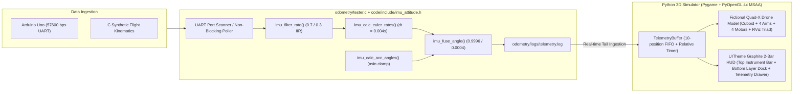

# Odometry Subsystem & 3D Flight Simulator (`odometry/`)

Real-time 3D flight telemetry visualization and C driver testbed for the quadcopter flight controller.

---

## 🏗️ Subsystem Architecture



---

## 🚀 Quickstart Guide

### 1. Launch the 3D Visualizer (`sim3d`)

You can launch the visualizer directly with `./sim3d`:

- **Real Hardware Serial Mode (Default — direct ingestion from USB):**
  ```bash
  ./sim3d
  # Or explicitly:
  ./sim3d --serialplot
  ./sim3d --serialplot --port /dev/ttyUSB0 --baud 57600
  ```

- **Synthetic Mock Mode (using C kinematics simulation):**
  ```bash
  ./sim3d --mock
  ```

---

### 2. Standalone C Driver Tester (`odometry/tester`)

If you want to run the low-level C harness independently (directly sharing `code/include/imu_attitude.h` via `-I../code/include`):
- **Build C Tester:**
  ```bash
  make -C odometry
  ```
- **Run C Tester (Hardware Serial):**
  ```bash
  ./odometry/tester
  ```
- **Run C Tester (Synthetic Mock):**
  ```bash
  ./odometry/tester -m
  ```

---

## 🎨 UI Architecture & Anti-AI Slop Design System (`UITheme`)

The 3D simulator interface was redesigned using knowledge synthesized from three architectural sources:
1. **World Info Vault (`Impeccable` Anti-AI Slop Principles)**:
   - Removed saturated neon cyan/green borders (`1px`), `bold=True` across all fonts, and ASCII pseudo-icons (`[✓]`, `[ ]`, `⌂`, `▼`).
   - Replaced scattered floating overlays with a structured **2-Bar Instrument Layout** (`TOP_BAR_HEIGHT = 52px`, compact bottom dock `DOCK_PILL_HEIGHT = 24px`, `DOCK_PILL_WIDTH = 74px`).
2. **Agency UI Designer & UX Architect Personas (`UITheme` Token System)**:
   - **Neutral Graphite Surfaces**: Deep canvas `(0.07, 0.08, 0.10)`, translucent slate panels `(22, 25, 32, 232)`, latest-row highlight `(38, 46, 60, 225)`, subtle borders `(56, 62, 76, 215)`, and internal hairline dividers `(48, 54, 68, 200)`.
   - **Interactive States**: Distinct `BTN_IDLE`, `BTN_HOVER` (mouse hover tracking), and `BTN_ACTIVE` `(56, 68, 90, 248)` with `BORDER_ACTIVE` `(98, 120, 158, 240)`.
   - **High-DPI Typography & Tabular Hierarchy**: Native Linux geometric sans (`DejaVu Sans,Ubuntu`, `14px`–`17px` regular) for muted uppercase labels and controls, paired with tabular monospace (`DejaVu Sans Mono,Ubuntu Mono`, `22px` bold for primary `ROLL`/`PITCH`/`YAW` readouts and `16px` for the 5-column `460px` telemetry drawer: `AMOSTRA`, `TEMPO`, `ROLL`, `PITCH`, `YAW`) so numeric updates at 25 Hz never jitter horizontally.
   - **Relative Session Time (`format_sample_time`)**: Converts raw 13-digit Unix epoch timestamps or simulation ms into clean relative session seconds (`12.4s`).
3. **Context7 (`Pygame` & `PyOpenGL` Hardware Anti-Aliasing)**:
   - **OpenGL 4x MSAA & Line Smoothing**: Configures `GL_MULTISAMPLEBUFFERS = 1` and `GL_MULTISAMPLESAMPLES = 4` prior to window creation (with graceful fallback), alongside `glEnable(GL_MULTISAMPLE)`, `glEnable(GL_LINE_SMOOTH)`, and `glHint(GL_LINE_SMOOTH_HINT, GL_NICEST)`.
   - **2D Vector Anti-Aliasing (`pygame.gfxdraw`)**: Renders smooth status indicator dots (`gfxdraw.aacircle` + `gfxdraw.filled_circle`) with a soft outer halo.

---

## 🎮 Simulator Controls & HUD Features

| Feature | Control / Interaction | Description |
| :--- | :--- | :--- |
| **Orbit Camera** | Left-Click + Drag | Rotates the viewpoint freely around the quadcopter (Azimuth & Elevation). |
| **Pan Camera** | Right-Click + Drag | Shifts the scene focal center. |
| **Zoom In / Out** | Mouse Wheel | Moves camera closer to or farther from the drone. |
| **Reset View** | Click **`Reset View`** or press `H` | Instantly restores camera to default isometric view ($45^\circ / 30^\circ$). |
| **Projection Toggle**| Click **`Perspective` / `Orthographic`** or press `P` | Switches between Orthographic Isometric and Perspective projections. |
| **Telemetry Drawer**| Click **`Telemetry`** or press `C` | Collapses or expands the right-hand tabular drawer (`TIME`, `ROLL`, `PITCH`, `YAW`) showing the 10-position FIFO buffer. |
| **Status Pill**| Top-Left Pill | **Anti-Aliased Green Dot (`ONLINE · SERIAL/MOCK`)**: active stream within $< 1.0\text{ s}$.<br>**Red Dot (`OFFLINE`)**: signal timeout / stream stalled. |
| **Attitude Readout**| Top-Center 3-Column Bar | High-DPI `22px` tabular monospace readout for live **ROLL**, **PITCH**, and **YAW**. |
| **RViz IMU Axes**| Center Origin Triad | **3D Orthogonal Axes at IMU Center**: Red = +X (Nose), Green = +Y (Right), Blue = +Z (Down/Vertical). |
| **Bottom Layer Dock**| Click Dock Pills or Keys `1`–`5`| **Individual Layer Toggles**: `[1] Body` · `[2] Arms` · `[3] Motors` · `[4] IMU Axes` · `[5] Grid`. |
| **Drone Manipulability**| None | **Non-manipulable**: Drone attitude (Roll, Pitch, Yaw) is 100% driven by telemetry. |


---

## 🧪 TDD Test Suite

All parsing, FIFO eviction, timeout tracking, and 3D kinematics are verified through automated Pytest suites:
```bash
PYTHONPATH=. .venv/bin/pytest odometry/tests/
```

