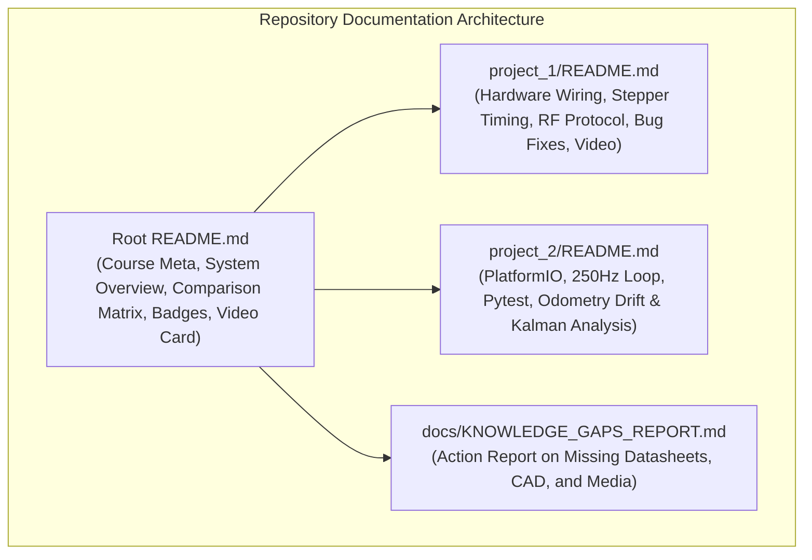

# Technical Design: Global Documentation & Multi-Project Governance

## Context & Architecture
The repository hosts two related projects targeting the ATmega328P microcontroller and MPU-6050 6-DoF IMU:
- `project_1`: A physical quadcopter test bench built with 4 stepper motors (28BYJ-48 + ULN2003 drivers), dual Arduinos (flight board + remote controller), HC-12 433 MHz RF link, and Pygame/PyOpenGL 3D visualizer (`envioadron.py`).
- `project_2`: A modular firmware platform managed via PlatformIO, featuring deterministic 250 Hz timing, 2-tick 25 Hz telemetry, automated Pytest testing (22/22 passing tests), and an odometry research engine investigating Zero-Velocity Update (ZUPT), deadband, and quadratic integration divergence.

## Goals & Non-Goals
### Goals
- Present the system with professional open-source standards (badges, clean tables, standard Mermaid diagrams).
- Honor academic governance (EESC-USP, SAA0356, Prof. Glauco Caurin with USP + Lattes links, team members).
- Clarify the evolutionary synergy: Project 1 implements the complete physical bench demonstration; Project 2 advances firmware architecture and odometry research.
- Formulate the mathematical basis of dead-reckoning divergence ($\iint a\,dt^2$) and justify multi-sensor Kalman filtering.
- Provide clean HTML video cards with clickable YouTube thumbnails and placeholder skeletons for future media.
- Document internal OpenSpec ephemeral lifecycle.

### Non-Goals
- Modifying production C++/Python binary logic during documentation phase.
- Implementing closed-source or commercial tool dependencies.

## Technical Decisions
1. **Language & Style**:
   - 100% English across all READMEs, markdown specifications, and code comments.
   - Harvard ATS / CAR style: straightforward, factual action verbs; zero promotional or hyperbolic adjectives.
2. **Mermaid Diagrams**:
   - Standard default interpreter styles only (no `style` or `classDef` properties) ensuring crisp readability on light and dark IDE themes.
3. **Multimedia Representation**:
   - High-compatibility HTML anchor block around YouTube thumbnail image (`https://img.youtube.com/vi/eWvYoFlVz2w/maxresdefault.jpg`) with fallback link.
4. **Ephemeral OpenSpec Governance**:
   - Isolated OpenSpec folders per subsystem (`openspec/`, `project_1/openspec/`, `project_2/openspec/`).
   - Clear invariant: permanent documentation persists in `docs/` and README files; OpenSpec is excluded upon public release.
