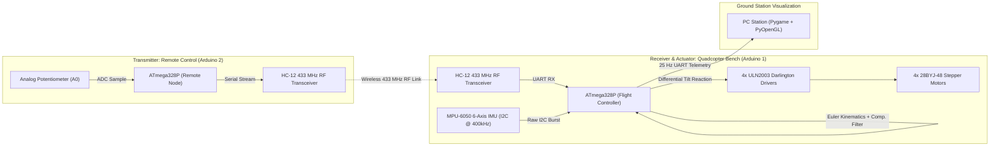
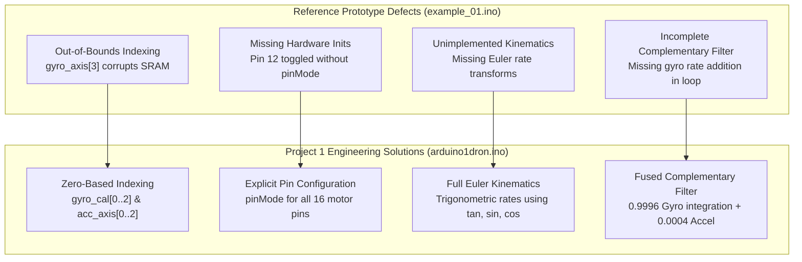
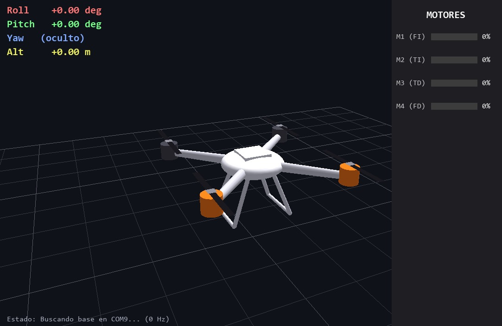
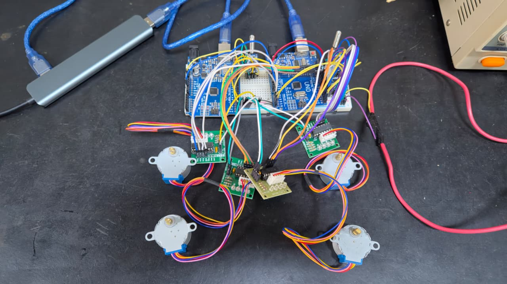

# Project 1: Physical Quadcopter Test Bench & Wireless Flight Stabilization

[](https://www.arduino.cc/)
[](https://www.microchip.com/)
[](https://invensense.tdk.com/)
[](https://www.elecrow.com/)
[](https://www.pygame.org/)
[](LICENSE)

> **Academic Coursework:** SAA0356 - Sistemas Embarcados para Veículos Aéreos (Turma 201)  
> **Institution:** Escola de Engenharia de São Carlos, Universidade de São Paulo (EESC - USP)  
> **Faculty Advisor:** [Prof. Dr. Glauco Augusto de Paula Caurin](https://saa.eesc.usp.br/inicial/docentes/professor-glauco-augusto-de-paula-caurin/) · [CNPq Lattes](https://buscatextual.cnpq.br/buscatextual/visualizacv.do;jsessionid=5DDECA9F6260EAC787DD75C20FAF833C.buscatextual_0)  
> **Authors / Development Team:** David Santiago Correa González, Juan Pablo Solano Mesa, Diego Alonso, Lucas Duarte  

---

## 1. System Overview

**Project 1** implements the complete, end-to-end physical prototype of an embedded quadcopter flight controller and telemetry test bench. The system integrates sensor acquisition, wireless telemetry, real-time motor actuation, and ground-station 3D visualization.



### Key Functional Capabilities
1. **Physical Test Bench Actuation:** Four 28BYJ-48 unipolar stepper motors driven by ULN2003 Darlington arrays demonstrate real-time motor mixing and differential tilt reaction without the safety hazards and high current draw of high-RPM brushless DC (BLDC) propellers in a laboratory environment.
2. **Dual-Arduino RF Link:** Arduino 2 acts as a wireless remote transmitter using an analog potentiometer and an HC-12 433 MHz RF transceiver to send motor enable (`S<0|1>`) and throttle power (`P<0..100>`) commands. Arduino 1 receives commands, controls the motors, and streams back telemetry.
3. **Attitude Determination:** MPU-6050 6-DoF IMU read over 400 kHz I2C within a deterministic $4000\,\mu\text{s}$ ($250\text{ Hz}$) control loop.
4. **Real-Time 3D Visualization:** A dedicated Pygame/PyOpenGL application (`envioadron.py`) renders an interactive 3D model of the quadcopter with live orientation, altitude estimate, and individual motor throttle bars.

---

## 2. Hardware Architecture & Pin Assignments

### 2.1 Arduino 1: Flight Controller & Motor Driver (`arduino1dron.ino`)
The flight controller reads the MPU-6050 IMU, processes radio commands, updates stepper motor timings, and transmits telemetry.

| Component / Subsystem | Pin(s) | Signal Type | Function & Electrical Details |
| :--- | :---: | :---: | :--- |
| **MPU-6050 IMU** | `A4` | I2C SDA | Data line, Fast Mode $400\text{ kHz}$, internal pull-ups enabled |
| **MPU-6050 IMU** | `A5` | I2C SCL | Clock line, Fast Mode $400\text{ kHz}$, internal pull-ups enabled |
| **Motor 1 — Front Right (FD)** | `2, 3, 4, 5` | Digital Out | Stepper IN1–IN4 to ULN2003 driver board |
| **Motor 2 — Rear Right (TD)** | `6, 7, 8, 9` | Digital Out | Stepper IN1–IN4 to ULN2003 driver board |
| **Motor 3 — Rear Left (TI)** | `10, 11, 12, 13` | Digital Out | Stepper IN1–IN4 to ULN2003 driver board |
| **Motor 4 — Front Left (FI)** | `A0, A1, A2, A3` | Digital Out | Stepper IN1–IN4 to ULN2003 driver board (configured as digital outputs) |
| **Hardware UART (Serial / RF)** | `0 (RX), 1 (TX)` | UART | Receives commands from HC-12 transceiver; transmits telemetry at $115{,}200\text{ bps}$ |

### 2.2 Arduino 2: Wireless Remote Controller (`arduino2control.ino`)
The handheld remote controller reads user input and transmits commands to the drone platform.

| Component / Subsystem | Pin(s) | Signal Type | Function & Electrical Details |
| :--- | :---: | :---: | :--- |
| **Throttle Potentiometer** | `A0` | Analog In | $10\text{ k}\Omega$ linear potentiometer (ADC $0\text{--}1023$ mapped to $0\text{--}100\%$ throttle) |
| **HC-12 433 MHz RF Transceiver** | `10 (RX), 11 (TX)` | `SoftwareSerial` | Wireless UART interface operating at $115{,}200\text{ bps}$ |
| **PC Debug Bridge** | `0 (RX), 1 (TX)` | Hardware UART | Relays incoming telemetry to PC Serial Monitor / Ground Station |

---

## 3. Mathematical Remediation of Course Reference Prototype (`example_01.ino`)

The initial reference prototype provided in the course material (`ref/DRONE_materialdeapoio/example_01.ino`) contained critical defects that prevented proper execution on ATmega328P hardware. `project_1/arduino1dron.ino` thoroughly audits and corrects each issue:



### 3.1 Audit & Comparison Matrix

| Defect in `example_01.ino` | Consequence on Hardware | Remediation in `arduino1dron.ino` |
| :--- | :--- | :--- |
| **Out-of-Bounds Array Access** (Lines 48–50, 140–142): Arrays declared as `int gyro_axis[3]` were indexed at `[1]`, `[2]`, `[3]`. | Index `[3]` writes past array bounds into adjacent memory, causing ATmega328P register corruption and erratic resets. | Corrected to standard zero-based indexing `gyro_cal[0]`, `gyro_cal[1]`, `gyro_cal[2]`. |
| **Missing Output Pin Configuration** (Line 44): Toggled pin 12 without `pinMode(12, OUTPUT)`. | Pin remained in high-impedance input mode; LED failed to illuminate. | Explicitly initialized all 16 stepper motor pins (`MOTOR_PINS[4][4]`) and indicators via `pinMode(pin, OUTPUT)`. |
| **Syntax Errors & Missing Declarations** (Lines 34, 37): `data` used without declaration; `intro()` missing trailing semicolon `;`. | Failed compilation on standard AVR-GCC compiler. | Cleaned syntax; properly scoped all loop variables. |
| **Unimplemented Attitude Kinematics** (Line 70: `//TODO: compute the angles`): Left Euler angle calculations unimplemented. | The quadcopter had no orientation tracking. | Implemented full Euler kinematic equations (Eq. 4–7) and accelerometer gravity projection (Eq. 8–10). |
| **Broken Complementary Filter** (Lines 78–79): Applied `angle_pitch = angle_pitch * 0.9996 + angle_pitch_acc * 0.0004`. | Lacked the gyro angular rate increment inside the integration step ($\dot{\theta}\Delta t$), causing angles to decay to zero. | Correctly integrated gyro angular rates prior to fusing with accelerometer tilt angles. |

### 3.2 Implemented Kinematic & Sensor Fusion Pipeline

1. **Stationary Gyroscope Calibration:**
   Averages 2000 samples at startup to determine resting bias offsets:
   $$\bar{b}_{gyro} = \frac{1}{2000} \sum_{i=1}^{2000} \text{gyro\_raw}_i$$

2. **Digital Low-Pass Rate Filter:**
   Suppresses high-frequency motor vibration:
   $$p_k = 0.7 \cdot p_{k-1} + 0.3 \cdot \left(\frac{\text{gyro\_x} - \bar{b}_x}{65.5}\right)$$
   $$q_k = 0.7 \cdot q_{k-1} + 0.3 \cdot \left(\frac{\text{gyro\_y} - \bar{b}_y}{65.5}\right)$$
   $$r_k = 0.7 \cdot r_{k-1} + 0.3 \cdot \left(\frac{\text{gyro\_z} - \bar{b}_z}{65.5}\right)$$

3. **Accelerometer Gravity Vector Projection:**
   $$a_{total} = \sqrt{a_x^2 + a_y^2 + a_z^2}$$
   $$\phi_{acc} = \arcsin\left(\frac{a_y}{a_{total}}\right) \cdot \frac{180^\circ}{\pi}$$
   $$\theta_{acc} = -\arcsin\left(\frac{a_x}{a_{total}}\right) \cdot \frac{180^\circ}{\pi}$$

4. **Non-Linear Euler Kinematic Rate Equations:**
   $$\dot{\phi} = p + q \tan\theta \sin\phi + r \tan\theta \cos\phi$$
   $$\dot{\theta} = q \cos\phi - r \sin\phi$$
   $$\dot{\psi} = (q \sin\phi + r \cos\phi) \sec\theta$$

5. **Complementary Filter Fusion:**
   Fuses the rapid dynamic response of the rate gyroscopes with the long-term drift-free reference of the accelerometer gravity vector:
   $$\phi_{fused} = 0.9996 \cdot (\phi + \dot{\phi} \cdot \Delta t) + 0.0004 \cdot \phi_{acc}$$
   $$\theta_{fused} = 0.9996 \cdot (\theta + \dot{\theta} \cdot \Delta t) + 0.0004 \cdot \theta_{acc}$$
   $$\psi_{fused} = \psi + \dot{\psi} \cdot \Delta t$$

6. **Earth-Frame Acceleration & Vertical Displacement:**
   Rotates body accelerations into the Earth reference frame to isolate vertical linear acceleration ($a_z^{earth}$), subtracting the calibrated resting gravity magnitude:
   $$z_{earth} = -a_x \sin\theta + a_y \sin\phi \cos\theta + a_z \cos\phi \cos\theta$$
   $$a_{vert} = -\left(z_{earth} - g_{cal}\right) \cdot \frac{9.81}{g_{cal}}$$
   $$v_z = v_z \cdot 0.995 + a_{vert} \cdot \Delta t$$
   $$p_z = p_z \cdot 0.990 + v_z \cdot \Delta t$$

---

## 4. Stepper Motor Actuation & Differential Tilt Compensation

### 4.1 Stepper Motor Scheduling Inside $4000\,\mu\text{s}$ Loop
Rather than blocking code execution with `delay()`, the firmware uses a non-blocking step scheduler:
- The 4-step excitation sequence `{B1000, B0100, B0010, B0001}` advances coils sequentially.
- Motor speed is governed by `delay_us[m]`, mapped inversely from motor power ($1\% \rightarrow 5000\,\mu\text{s}$, $100\% \rightarrow 1000\,\mu\text{s}$).
- The firmware steps motors within the remaining idle time of the $4000\,\mu\text{s}$ loop period:
  ```cpp
  while (micros() - loop_timer < LOOP_US) {
    runSteppers();
  }
  loop_timer = micros();
  ```

### 4.2 Proportional Tilt Reaction Law
To demonstrate active flight stabilization on the bench, differential power adjustments counteract manual displacement:
$$adj_{pitch} = k \cdot \theta, \quad adj_{roll} = k \cdot \phi \quad (k = 2.0)$$
$$pwr_0 = P_{global} + adj_{pitch} - adj_{roll} \quad (\text{M1: Front Right / FD})$$
$$pwr_1 = P_{global} - adj_{pitch} - adj_{roll} \quad (\text{M2: Rear Right / TD})$$
$$pwr_2 = P_{global} - adj_{pitch} + adj_{roll} \quad (\text{M3: Rear Left / TI})$$
$$pwr_3 = P_{global} + adj_{pitch} + adj_{roll} \quad (\text{M4: Front Left / FI})$$

```
          FRONT
      M4 (FL)   M1 (FR)
         \     /
          \   /
           \ /
           / \
          /   \
         /     \
      M3 (RL)   M2 (RR)
           REAR
```

- **Pitch Forward ($\theta > 0$):** Front motors M1 and M4 accelerate, producing upward lift at the front to counteract the forward tilt.
- **Pitch Backward ($\theta < 0$):** Rear motors M2 and M3 accelerate, leveling the platform.
- **Roll Left ($\phi < 0$):** Left motors M3 and M4 accelerate, producing upward lift on the left side.
- **Roll Right ($\phi > 0$):** Right motors M1 and M2 accelerate, restoring horizontal equilibrium.

---

## 5. Wireless RF Protocol & Telemetry Stream

### 5.1 Remote Control Protocol (Arduino 2 $\rightarrow$ Arduino 1)
Commands are transmitted asynchronously across the HC-12 433 MHz link as ASCII strings terminated by newline (`\n`):

| Command String | Parameter Format | Description | Example Payload |
| :--- | :--- | :--- | :--- |
| `S<state>\n` | Integer: `1` (Enable) or `0` (Disable) | Safety arm/disarm state for all 4 stepper motors. | `S1\n` |
| `P<power>\n` | Integer: `0` to `100` | Global throttle baseline applied across the motor mixer. | `P55\n` |

### 5.2 Decimated Serial Telemetry (Arduino 1 $\rightarrow$ PC Ground Station)
To maintain real-time loop execution, telemetry is decimated by a factor of 10 ($250\text{ Hz} / 10 = 25\text{ Hz}$):
```
Roll:<float>,Pitch:<float>,Yaw:<float>,Alt:<float>
M1:<int>,M2:<int>,M3:<int>,M4:<int>
```
*Example line:*
```
Roll:4.25,Pitch:-2.10,Yaw:0.00,Alt:0.1240
M1:52,M2:48,M3:48,M4:52
```

---

## 6. Real-Time 3D Ground Station Visualizer (`envioadron.py`)

The ground station software provides live orientation tracking and instrument readouts:
- **Background Thread (`RFController`):** Ingests $115{,}200\text{ bps}$ serial data, parses telemetry using regular expressions, and maintains a thread-safe state buffer.
- **OpenGL 3D Quadcopter Model:** Displays fuselage, arms, landing gear, and animated propellers rotating at speeds proportional to individual motor power levels.
- **HUD Instruments:** Displays real-time numerical roll, pitch, yaw, altitude, serial update rate ($Hz$), and individual color-coded motor throttle bars ($0\text{--}100\%$).
- **Interactive Camera:** Click and drag to orbit around the quadcopter; mouse wheel to zoom in and out. Press `Z` to tare attitude to zero.

---

## 7. Physical Bench Demonstration & Hardware Video

The physical integration of the quadcopter bench, dual Arduinos, wireless RF link, and stepper tilt reaction was documented and verified:

<div align="center">
  <a href="https://www.youtube.com/watch?v=eWvYoFlVz2w" target="_blank">
    
  </a>
  <p><em>Click the image above to view the demonstration on YouTube: <a href="https://www.youtube.com/watch?v=eWvYoFlVz2w">https://www.youtube.com/watch?v=eWvYoFlVz2w</a></em></p>
</div>

### Demonstration Summary (from `transcribe.txt`)
In the recorded demonstration:
1. The presenter explains the dual-Arduino embedded architecture: the wireless handheld controller communicating over HC-12 radiofrequency and the on-board flight controller.
2. The quadcopter platform is manually tilted along the pitch and roll axes.
3. As the platform tilts forward, the front stepper motors instantly increase speed; when tilted backward, the rear motors engage. Similarly, lateral roll activates the corresponding left and right motor pairs.
4. The Pygame/PyOpenGL 3D visualizer mirrors the physical platform's angular movements in real time, validating the complete sensor-to-actuator and telemetry pipeline.

---

## 8. Hardware Image Gallery

| Platform Assembly Overview | Exploded Hardware Wiring Diagram |
| :---: | :---: |
|  |  |
| *Figure 1: Assembled quadcopter test bench showing wooden frame, central Arduino Uno, breadboard, MPU-6050, and 28BYJ-48 stepper motors.* | *Figure 2: Wiring schematic detailing pin connections between Arduino, ULN2003 driver modules, MPU-6050, and HC-12 transceiver.* |

---

## 9. Quickstart Guide

### 9.1 Flashing Firmware
1. Open `project_1/arduino1dron.ino` in the Arduino IDE.
2. Select **Board:** `Arduino Uno` and choose the corresponding serial port.
3. Compile and upload to the flight controller Arduino.
4. Connect the remote controller Arduino and upload `project_1/arduino2control.ino`.

### 9.2 Launching the 3D Ground Station
```bash
# Install Python dependencies
pip install pygame pyopengl pyserial

# Launch the visualizer specifying active serial port
python envioadron.py --port /dev/ttyUSB0 --baud 115200
```

---

## 10. Ephemeral OpenSpec Governance Note

> [!NOTE]
> All artifacts within `project_1/openspec/` represent internal development contracts used to plan and verify this implementation. In accordance with the repository's OpenSpec governance rule, these internal specification folders will be omitted from the final public Git distribution, leaving this document as the primary reference.
