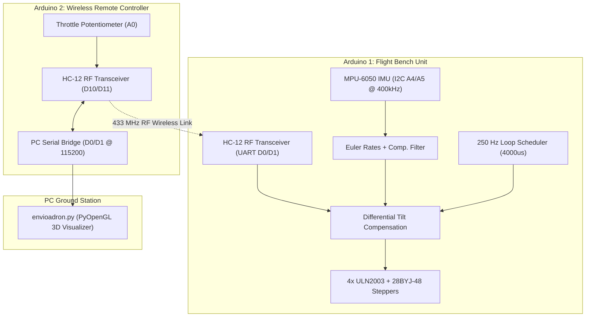

# Technical Design: Project 1 Hardware Bench Integration & Prototype Remediation

## Context & Architecture
`project_1` addresses the physical validation of an embedded flight controller on a laboratory test bench. Rather than risking high-speed BLDC propellers, the system utilizes four 28BYJ-48 unipolar stepper motors connected to ULN2003 Darlington transistor array drivers.

## Goals & Non-Goals
### Goals
- Formally document the hardware setup, pinout, stepper motor drive logic, and RF protocol.
- Clarify the mathematical remediation that turned the broken `example_01.ino` prototype into a working flight platform.
- Embed interactive media cards (YouTube demonstration video and image gallery) into `project_1/README.md`.
- Ensure strict compliance with the OpenSpec ephemeral lifecycle rule.

### Non-Goals
- Refactoring the underlying `.ino` firmware or altering pin assignments.
- Replacing the 28BYJ-48 stepper motors with BLDC motors on the bench.

## Technical Decisions
1. **Stepper Non-Blocking Drive Scheme**:
   - Steppers use full-step 4-phase sequences `{B1000, B0100, B0010, B0001}` executed sequentially inside `runSteppers()`.
   - The execution loop reserves the remaining time of the $4000\,\mu\text{s}$ cycle (`while (micros() - loop_timer < LOOP_US)`) to step active motors without blocking sensor acquisition.
2. **Tilt Reaction & Proportional Feedback**:
   - Compensation gain $k = 2.0$ provides noticeable visual response during manual bench tilting.
   - Forward pitch activates front motors M1 and M4; backward pitch activates rear motors M2 and M3; left tilt activates left motors M3 and M4; right tilt activates right motors M1 and M2.
3. **Decimated 25 Hz Serial Telemetry**:
   - Telemetry output occurs once every 10 cycles ($25\text{ Hz}$), streaming attitude angles (`Roll`, `Pitch`, `Yaw`, `Alt`) and individual motor power levels (`M1`–`M4`) over serial to `envioadron.py`.
