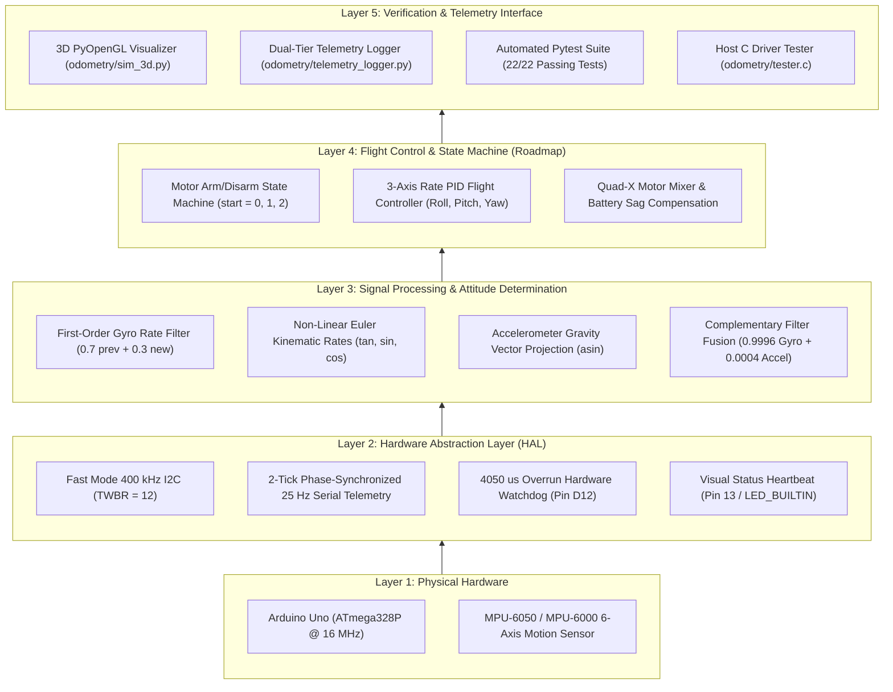
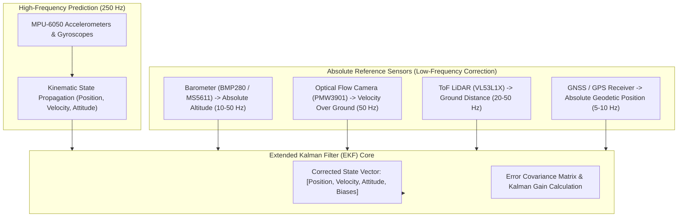

# Project 2: High-Reliability Flight Controller Architecture & 3D Odometry Research

[](https://platformio.org/)
[](https://www.microchip.com/)
[](https://invensense.tdk.com/)
[%20%2B%20TDD-purple.svg)]()
[](LICENSE)

> **Academic Coursework:** SAA0356 - Sistemas Embarcados para Veículos Aéreos (Turma 201)  
> **Institution:** Escola de Engenharia de São Carlos, Universidade de São Paulo (EESC - USP)  
> **Faculty Advisor:** [Prof. Dr. Glauco Augusto de Paula Caurin](https://saa.eesc.usp.br/inicial/docentes/professor-glauco-augusto-de-paula-caurin/) · [CNPq Lattes](https://buscatextual.cnpq.br/buscatextual/visualizacv.do;jsessionid=5DDECA9F6260EAC787DD75C20FAF833C.buscatextual_0)  
> **Author & Research Lead:** Lucas Duarte  

---

## 1. System Overview & Bottom-Up SDD Architecture

**Project 2** establishes a modular embedded flight controller firmware and inertial odometry research platform for the ATmega328P microcontroller. Developed under **Spec-Driven Development (SDD)** and **Test-Driven Development (TDD)**, the codebase enforces strict separation of concerns, deterministic $250\text{ Hz}$ execution timing, dual-rate serial telemetry decimation, and forensic mathematical testing.



### Complete Documentation Index
- 📄 **[docs/system_architecture.md](docs/system_architecture.md):** 5-layer bottom-up register maps, pinouts, and complete mathematical derivations.
- 📄 **[docs/system_purpose.md](docs/system_purpose.md):** Architectural motivations, incremental 4-stage roadmap, and safety invariants.
- 📈 **[docs/CHANGELOG.md](docs/CHANGELOG.md):** Chronological version history following Keep a Changelog.
- 📐 **[docs/adr/](docs/adr/):** Architectural Decision Records (ADR-0001 through ADR-0004).
- 📜 **[openspec/specs/](openspec/specs/):** Formal EARS specifications with GIVEN/WHEN/THEN test scenarios.

---

## 2. Firmware Engineering & PlatformIO Architecture

The firmware is structured within the `code/` directory, compiled via PlatformIO:

```
project_2/
├── platformio.ini              # Multi-environment PlatformIO configuration
├── code/
│   ├── include/
│   │   ├── drone_config.h      # Global timing, pinout, and filter constants
│   │   └── imu_attitude.h      # Pure C math routines (shared with tester.c)
│   └── src/
│       ├── main.cpp            # Primary 250 Hz flight controller firmware
│       └── i2c_finder.cpp      # Standalone 100 kHz I2C diagnostic scanner
├── odometry/                   # Python 3D simulation and TDD test harness
└── docs/                       # Complete architectural reference documentation
```

### 2.1 Deterministic 250 Hz Loop Budget & Overrun Watchdog
- **Cycle Period:** Exactly $4000\,\mu\text{s}$ ($250\text{ Hz}$), enforced by `while (micros() - loop_timer < LOOP_TIME_US)`.
- **Execution Watchdog:** If sensor reading, kinematics, and serial transmission exceed $4050\,\mu\text{s}$, digital pin `12` (`PIN_LED_WARNING`) is immediately driven HIGH, signaling timing violation.

### 2.2 Split 2-Tick Phase-Synchronized Telemetry (25 Hz)
Standard 9-character floating-point serial transmissions can take $1500\text{--}2500\,\mu\text{s}$ at $57{,}600\text{ bps}$, risking cycle overrun if transmitted in a single loop iteration. Project 2 implements a split 2-tick transmission scheme across its 10-tick decimation window:
- **Tick 5 ($20\text{ ms}$):** Latches the 10-tick averaged accelerometer vector (`snap_ax_g, snap_ay_g, snap_az_g`) and emits attitude angles:
  `Roll Pitch Yaw `
- **Tick 10 ($40\text{ ms}$):** Emits the latched acceleration vector with 4 decimal places ($1/4096 \approx 0.00024g$ resolution) followed by newline:
  `Ax Ay Az\n`
- **Visual Heartbeat (Pin 13):** Toggles the onboard LED every 10 telemetry transmission cycles ($400\text{ ms} = 1.25\text{ Hz}$), confirming real-time loop execution.

### 2.3 Single-Source Testable Math Headers
Kinematic filter functions in `code/include/imu_attitude.h` are implemented as pure C functions with zero hardware dependencies (`Arduino.h` free). This allows host compilation and testing in `odometry/tester.c` via standard `gcc` without an Arduino board.

---

## 3. Automated Testing & Verification Suite (Dual-Role TDD)

The subsystem incorporates a dual-role Test-Driven Development (TDD) harness verified in an isolated virtual environment (`.venv`):

```bash
# Execute the full automated test suite
.venv/bin/pytest odometry/tests/ -v
```

```
============================= test session starts ==============================
collected 22 items

odometry/tests/test_drone_model.py::test_drone_dimensions_initialization PASSED
odometry/tests/test_drone_arm_endpoints PASSED
odometry/tests/test_drone_model.py::test_euler_to_matrix_identity PASSED
odometry/tests/test_drone_model.py::test_euler_to_matrix_pure_rotations PASSED
odometry/tests/test_drone_model.py::test_inertial_position_estimator_rest PASSED
odometry/tests/test_drone_model.py::test_inertial_position_estimator_integration PASSED
odometry/tests/test_drone_model.py::test_inertial_position_estimator_zero_reset PASSED
odometry/tests/test_drone_model.py::test_fading_trajectory_trail PASSED
odometry/tests/test_drone_model.py::test_inertial_estimator_decimals_and_saved_methods PASSED
odometry/tests/test_telemetry_reader.py::test_telemetry_record_parsing PASSED
odometry/tests/test_telemetry_reader.py::test_telemetry_record_invalid_line PASSED
odometry/tests/test_telemetry_reader.py::test_telemetry_buffer_fifo PASSED
odometry/tests/test_telemetry_reader.py::test_telemetry_buffer_snapshot PASSED
odometry/tests/test_telemetry_reader.py::test_telemetry_buffer_heartbeat PASSED
odometry/tests/test_telemetry_reader.py::test_read_serial_port_from_ini PASSED
...
============================== 22 passed in 0.21s ==============================
```

---

## 4. Odometry & Inertial Navigation Research

A primary research contribution of Project 2 is the formal investigation of **Inertial Dead-Reckoning Odometry** conducted in `project_2/odometry/drone_model.py`.


### 4.1 Numerical Integration Methods Investigated
Three discrete numerical integration methods were implemented and evaluated in `InertialPositionEstimator`:

1. **Method 1: First-Order Base Euler Kinematics (`base_euler`):**
   $$v_k = v_{k-1} + a_k \cdot \Delta t$$
   $$p_k = p_{k-1} + v_k \cdot \Delta t$$
   *Analysis:* Lowest computational overhead; introduces first-order truncation error proportional to $\mathcal{O}(\Delta t)$.

2. **Method 2: Second-Order Trapezoidal Integration (`trapezoidal`):**
   $$v_k = v_{k-1} + \frac{1}{2}(a_{k-1} + a_k) \cdot \Delta t$$
   $$p_k = p_{k-1} + \frac{1}{2}(v_{k-1} + v_k) \cdot \Delta t$$
   *Analysis:* Reduces discretization error to $\mathcal{O}(\Delta t^2)$, yielding smoother trajectory profiles during sustained accelerations.

3. **Method 3: Zero-Velocity Update Integration (`zupt`):**
   Trapezoidal integration paired with an adaptive stationary detector that attenuates residual velocity when linear acceleration is below the noise floor for $\ge 3$ consecutive cycles.

### 4.2 Noise Floor Mitigation: $0.05g$ Deadband & Static Tare
Even when completely motionless on a table, MEMS sensor noise on the MPU-6050 fluctuates by $\pm 0.015g$ to $\pm 0.040g$. Unfiltered, this noise integrates into fictitious velocities exceeding $1.5\text{ m/s}$ within 5 seconds.
- **Deadband Threshold ($0.05g$):** Any world-frame linear acceleration with Euclidean magnitude $\|a_w\| < 0.05g$ ($< 0.4905\text{ m/s}^2$) is clamped to zero:
  $$\text{if } \|a_w\| < 0.05g \implies a_w = [0, 0, 0]^T$$
- **Stationary Bias Tare (`zero_position(tare_bias=True)`):** Captures resting acceleration offsets immediately prior to flight maneuvers, compensating for minor surface slopes.

### 4.3 Mathematical Proof: Why Standalone Double Integration Diverges Quadratically

In classical inertial navigation, position $p(t)$ is derived by integrating acceleration twice:
$$v(t) = v(0) + \int_{0}^{t} a(\tau)\,d\tau$$
$$p(t) = p(0) + \int_{0}^{t} v(\tau)\,d\tau = p(0) + v(0)t + \int_{0}^{t} \int_{0}^{\tau} a(\sigma)\,d\sigma\,d\tau$$

Assume a consumer-grade MEMS accelerometer exhibits an uncompensated bias error $b_a$ (caused by temperature drift, mechanical stress, or an attitude estimation tilt error $\delta\theta$ causing gravity leakage $b_a \approx g \sin\delta\theta$):
$$a_{measured}(t) = a_{true}(t) + b_a$$

Integrating the measured signal results in:
$$v_{measured}(t) = v_{true}(t) + b_a \cdot t$$
$$p_{measured}(t) = p_{true}(t) + \underbrace{\frac{1}{2} b_a \cdot t^2}_{\text{Quadratic Error Drift } e_p(t)}$$

```
Position Error (m)
   ^
   |                                          * (Quadratic Divergence: e_p ~ 0.5 * b_a * t^2)
   |                                      *
   |                                  *
   |                              *
   |                         *
   |                    *
   |               *
   |          *
   |    *
   +---------------------------------------------> Time (seconds)
```

#### Quantitative Error Accumulation
Even with an extraordinarily small residual bias of $b_a = 0.01\text{ m/s}^2$ ($\approx 1\text{ mg}$):
- **After 10 seconds:** $e_p(10) = \frac{1}{2}(0.01)(10)^2 = 0.5\text{ meters}$.
- **After 30 seconds:** $e_p(30) = \frac{1}{2}(0.01)(30)^2 = 4.5\text{ meters}$.
- **After 60 seconds:** $e_p(60) = \frac{1}{2}(0.01)(60)^2 = 18.0\text{ meters}$.

Under real-world conditions with an MPU-6050, bias instability and tilt errors typically exceed $10\text{--}50\text{ mg}$, causing open-loop position estimates to drift by tens of meters within seconds.

### 4.4 Why Zero-Velocity Update (ZUPT) Cannot Solve Flight Divergence
Zero-Velocity Update (ZUPT) works by detecting when the sensor is stationary (e.g., when the drone is on the ground or resting on a surface) and clamping velocity to zero:
$$v_k \leftarrow 0.5 \times v_k \quad (\text{when stationary for } \ge 3 \text{ frames})$$

**The Fundamental Limitation:**
- ZUPT is active **only when the drone is motionless**.
- During active flight (hovering, climbing, translational maneuvering), acceleration is continuously non-zero. ZUPT cannot activate without corrupting legitimate flight dynamics.
- Consequently, while ZUPT successfully eliminates drift **at rest**, position integration **diverges immediately once airborne**.

### 4.5 Concluding Engineering Recommendation: Multi-Sensor Kalman Fusion

> [!IMPORTANT]
> **Engineering Conclusion:**  
> Standalone MEMS IMU double integration is mathematically incapable of providing stable position estimation for autonomous unmanned aerial vehicles. Open-loop dead-reckoning will always diverge quadratically over time.

To achieve reliable 3D position hold and autonomous navigation, the flight controller **must incorporate multi-sensor fusion algorithms**, specifically an **Extended Kalman Filter (EKF)** or **Unscented Kalman Filter (UKF)**:



The EKF continually estimates sensor bias states ($b_a, b_g$) and bounds the covariance matrix, correcting inertial drift with absolute reference measurements:
1. **Vertical Axis ($Z$):** Fusing high-frequency vertical acceleration with barometric pressure and downward ToF LiDAR prevents vertical drift and enables precise altitude hold.
2. **Horizontal Planar Axes ($X, Y$):** Fusing horizontal accelerations with optical flow (indoor) or GPS (outdoor) bounds velocity and position drift to centimeter-level accuracy.

---

## 5. Real-Time 3D Simulation & Telemetry Visualizer (`odometry/`)

The Python 3D simulation environment provides visual validation of firmware telemetry:

<div align="center">
  <div style="background: #18191c; padding: 24px; border-radius: 8px; border: 1px solid #333; margin: 16px 0;">
    <p style="color: #888; font-family: monospace; margin: 0 0 12px 0;">[ Project 2 3D Odometry Simulation Video Placeholder ]</p>
    <p style="color: #ccc; font-size: 0.95em; line-height: 1.5; margin: 0;">
      A dedicated high-definition demonstration video of the 3D Pygame/PyOpenGL simulator, real-time MPU-6050 attitude tracking, and live ZUPT odometry behavior will be linked here in the upcoming iteration.
    </p>
  </div>
</div>

### Interactive Controls
| Key / Input | Action | Function |
| :--- | :--- | :--- |
| **Left Click + Drag** | Orbit Camera | Rotates azimuth and elevation around the quadcopter |
| **Mouse Wheel** | Zoom Camera | Adjusts camera distance from $2.0\text{ m}$ to $25.0\text{ m}$ |
| **P Key** | Toggle Projection | Switches between Perspective ($45^\circ$) and Orthographic Isometric view |
| **Z Key** | Zero Odometry | Resets 3D position to $(0, 0, H_0)$ and tares resting bias |
| **C Key** | Recalibrate IMU | Sends `'C'` command over serial to trigger Arduino level recalibration |
| **G Key** | Toggle Ground Drop | Displays vertical laser drop line to the $Z=0$ ground plane |
| **T Key** | Toggle Trajectory | Shows/hides time-fading 3D position trajectory ribbon |
| **ESC** | Exit Simulator | Closes serial port cleanly and terminates Pygame window |

---

## 6. Verified Operational Commands

All commands below have been tested and verified within the repository environment:

| Target Task | Command | Operational Notes |
| :--- | :--- | :--- |
| **Compile Firmware** | `pio run -e uno` | Compiles `code/src/main.cpp` using AVR-GCC toolchain |
| **Upload Firmware** | `pio run -e uno -t upload` | Flashes ATmega328P via active serial port (`/dev/ttyUSB1`) |
| **Run Diagnostic I2C Scanner** | `pio run -e i2c_finder -t upload` | Scans I2C bus (`0x01`–`0x7E`) and validates A4/A5 pull-ups |
| **Run 3D Simulator (Standard)** | `.venv/bin/python odometry/sim_3d.py --port /dev/ttyUSB1` | Runs real-time 3D simulation with ZUPT, $0.05g$ deadband, and 1 Hz heartbeat |
| **Run 3D Simulator (Verbose)** | `.venv/bin/python odometry/sim_3d.py --port /dev/ttyUSB1 -v` | Emits microsecond-level diagnostics with $\Delta t$, clamping tags, and ZUPT tags |
| **Replay Recorded Telemetry** | `.venv/bin/python odometry/sim_3d.py --file odometry/logs/telemetry.log` | Replays pre-recorded telemetry stream without physical hardware connected |
| **Run Full TDD Test Suite** | `.venv/bin/pytest odometry/tests/ -v` | Runs all 22 automated Pytest unit and integration tests |
| **Compile C Driver Tester** | `make -C odometry` | Builds standalone host test binary `odometry/tester` using GCC |

---

## 7. Ephemeral OpenSpec Governance Note

> [!NOTE]
> All artifacts within `project_2/openspec/` represent internal development contracts used to plan and verify this implementation. In accordance with the repository's OpenSpec governance rule, internal specification folders will be omitted from the final public Git distribution, leaving this document and `project_2/docs/` as the primary references.
